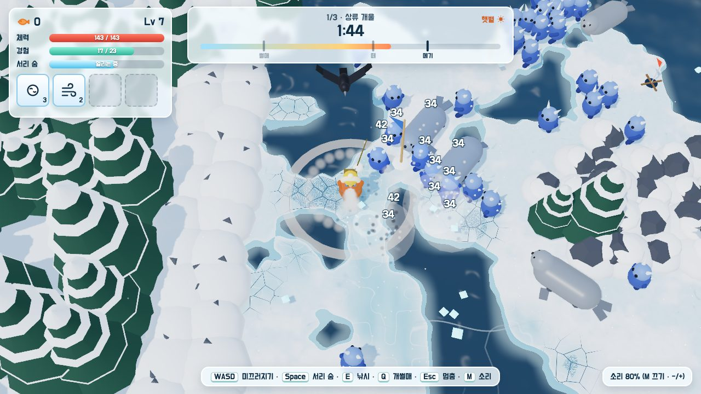
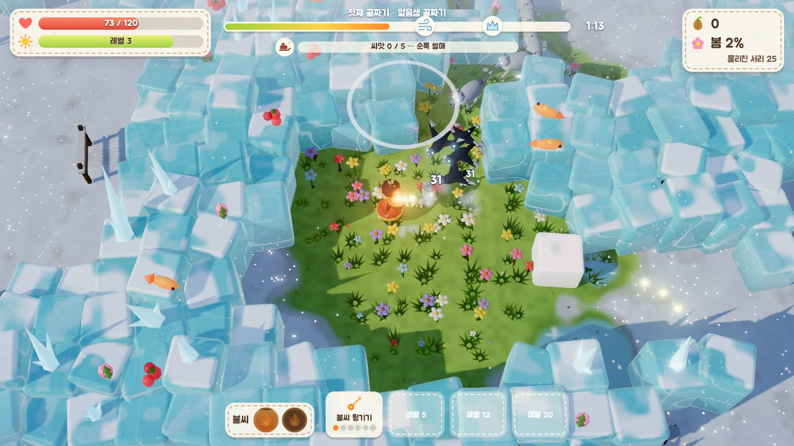
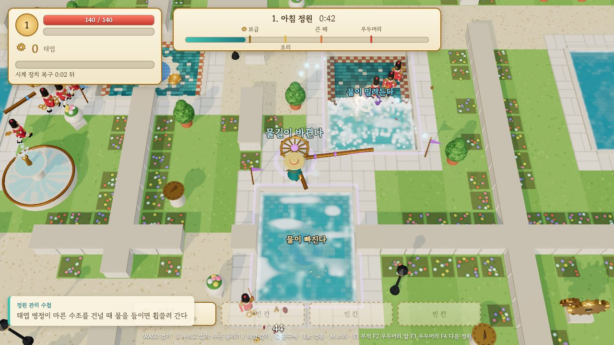
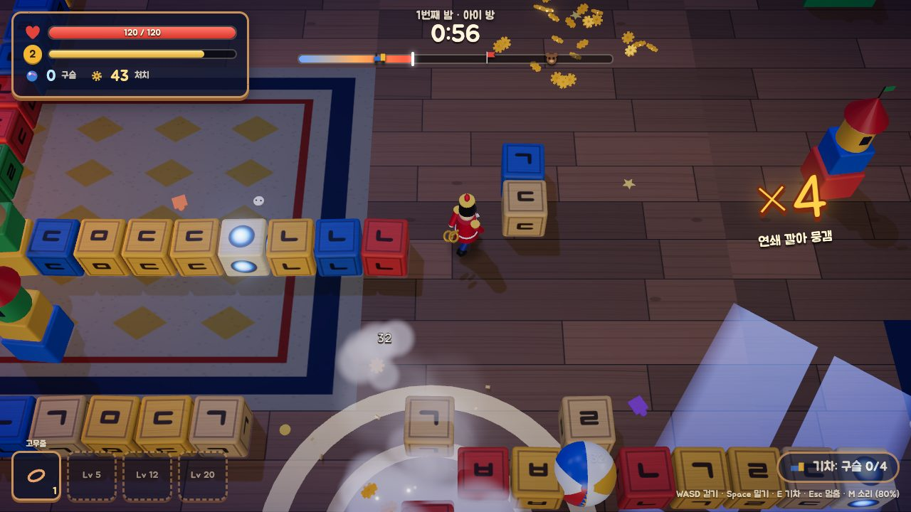

나는 AI 에이전트들과 게임을 만든다. 요즘은 이미 나온 게임을 [레퍼런스 게임](#g-reference)으로 삼아 작은 웹 게임으로 만드는 일을 많이 한다. 이번 레퍼런스 게임은 [Deep Rock Galactic: Survivor](#g-drgs)였다. 플레이어는 외계 행성의 동굴에 내려온 드워프 광부다. 무기는 저절로 쏘고, 플레이어는 움직이기만 한다. 사방에서 벌레 [호드](#g-horde)(horde, 떼로 몰려오는 적)가 밀려온다. 바위벽으로 걸어 들어가면 벽이 깎여 길이 나고, 벽에 박힌 광석을 캐면 그것으로 장비를 강화한다. 캐려면 멈추거나 느려져야 해서 그사이 호드가 다가온다. 레벨이 오를 때마다 카드 셋 가운데 하나를 골라 무기와 캐릭터를 강화한다.

처음에 에이전트는 이 게임을 그대로 옮겨 만들었다. 이 글의 대화 앞쪽에서는 레퍼런스 게임을 '원작'이라고 부른다. 원작의 그림과 이름을 쓰니 공개할 수 없었다. 그래서 우리 것으로 바꾸기로 했다. 먼저 그림과 이름만 바꾼 버전 둘을 만들었다. 곤충이 사는 '정원 아래'와 화석이 깨어나는 '화석 발굴지'다. 나는 둘 다 원작과 너무 비슷하다고 판정했다. 나는 원작의 [다이내믹스](#g-dynamics)는 지키되 전혀 다른 게임을 지어 보라고 했다. 에이전트는 원작의 다이내믹스 일곱을 원작의 그림이나 세계 같은 테마를 빼고 적었다. 떼를 베어 내는 성장, 빌드 고르기, 막는 지형, 위험한 수입, 스테이지의 절정, 여러 스테이지의 하강, 곁가지다. 그리고 그 다이내믹스가 일어나게 할 [핵심 동사](#g-verb)와 세계를 새로 만들었다. 먼저 그림 없는 [그레이박스](#g-greybox)로 넷을 지어 견주고, 이어서 3D와 스테이지 셋, 상점, 소리까지 갖춘 완성판으로 키웠다. 하루 사이에 시제품 넷이 나왔다. 다만 그레이박스 단계에서는 넷 모두 '몰림'이 약했다. 몰림은 막는 지형 때문에 호드에 몰렸다가 빠져나가는 긴장이다.

| 게임(이 대화 때의 이름) | 무엇을 하는가 |
| --- | --- |
| 살얼음 | 스케이트를 타는 얼음낚시꾼이 물을 얼려 호드를 막고, 얼음에 구멍을 뚫어 고기를 낚아 수입을 얻는다 |
| 봄을 데려오는 아이 | 화로를 멘 봄의 정령이 불씨를 던져 얼음을 녹이고, 씨앗 위에 멈춰 서서 싹을 틔운다 |
| 수문 | 플레이어가 수문을 돌려 수조의 물을 옮기며 태엽 군대를 견딘다 |
| 블록 밀기 | 아이가 잠든 밤, 태엽 병정이 나무 블록을 밀어 먼지 군단을 깔아 뭉갠다. 나는 대화에서 이 게임을 '장난감 병정'이라고 불렀고, 지금 이름은 '태엽 병정의 밤'이다 |

  <figure>
    
    <figcaption><strong>살얼음</strong><em>얼음낚시꾼(가운데 주황 옷)이 숨으로 물을 얼려 길을 내는 사이 호드가 몰려온다</em></figcaption>
  </figure>
  <figure>
    
    <figcaption><strong>봄을 데려오는 아이</strong><em>봄의 정령이 불씨로 녹인 풀밭에 서 있고, 둘레는 아직 녹지 않은 얼음이다</em></figcaption>
  </figure>
  <figure>
    
    <figcaption><strong>수문</strong><em>정원지기가 수문 바퀴를 돌려 한쪽 수조의 물을 빼고 다른 수조로 보내 태엽 병정을 휩쓴다</em></figcaption>
  </figure>
  <figure>
    
    <figcaption><strong>블록 밀기</strong><em>태엽 병정이 나무 블록을 밀어 먼지 군단을 깔아 뭉갠다</em></figcaption>
  </figure>

넷 모두 바위벽을 깎지 않는다. 나는 넷을 한 번씩 얕게 플레이해 보고, 독창적이면서 원작의 재미를 어느 정도 지켰다고 판정했다. 에이전트가 잰 바로는 완성판 하나를 짓는 데 에이전트 작업 시간으로 약 한 시간이 들었다.

이 일은 내 프로젝트 drg-survivor에서 했다. 이름이 닮았지만 DRG: Survivor는 레퍼런스 게임이고, drg-survivor는 그 게임을 레퍼런스로 삼아 이 게임들을 만든 내 프로젝트다. 프로젝트마다 그 일을 맡은 에이전트가 따로 있다.

그림과 이름, 핵심 동사, 세계를 모두 바꿨는데도 원작의 재미가 어느 정도 남았다면, 넷이 원작에서 옮겨 온 것은 무엇일까. 그리고 그것을 어떻게 적어 두어야 다음 게임에도 다시 쓸 수 있을까.

이 글은 그 물음을 에이전트와 따진 대화다. 대화 상대는 내 게임 프로젝트 여럿을 관리하는 매니저 에이전트다. 대화는 2026년 10월 20일 낮 12시 56분부터 오후 4시 11분까지 이어졌다. 우리는 넷이 옮겨 온 것이 다이내믹스라고 보았다. 그리고 건축가 [크리스토퍼 알렉산더](#g-alexander)의 [패턴 언어](#g-patternlanguage)를 빌려, 다이내믹스를 [다이내믹스 패턴](#g-pattern)으로 적어 쌓고 그것으로 게임을 짓는 방법을 정리했다. 나는 이 정리를 앞으로 일할 때 이정표로 삼기로 했다.

흐름을 바꾼 대목만 골라 시간 순서대로 옮긴다. 내 말은 맞춤법과 띄어쓰기만 다듬었다. 에이전트의 답은 원문 문장을 살려 줄였다. 절 사이의 짧은 설명과 괄호 안의 설명은 내가 덧붙였다. 밑줄 친 말을 누르면 글 끝의 [용어 사전](#glossary)으로 간다.

## MDA와 다이내믹스

이 대화에는 [MDA 프레임워크](#g-mda)의 말이 자주 나온다. MDA는 게임을 세 층으로 본다.

- **[메커닉스](#g-mechanics):** 게임의 규칙. 예: 벽으로 걸어 들어가면 벽이 깎인다.
- **[다이내믹스](#g-dynamics):** 규칙이 실제 플레이에서 만들어 내는 움직임. 예: 광석을 캐려고 멈춘 사이 호드가 다가온다.
- **[에스테틱스](#g-aesthetics):** 플레이어가 느끼는 재미. 예: 조금만 더 캐고 달아날지 저울질하는 긴장.

에이전트가 테마를 뺀 말로 적은 것은 이 가운데 다이내믹스였다. 이번 시도는 그림과 이름, 핵심 동사, 세계가 모두 바뀌어도 다이내믹스는 남을 수 있다는 생각에서 출발했다.

## 무엇이 그대로 남았나

대화는 그 시도의 경위를 내가 다시 짚는 데서 시작했다.

### 경위 (12:56)

**강PD** drg-survivor를 오리지널리티를 부여하려는 시도를 했는데 잘되지 않았다. '정원 아래' '화석 발굴지' 프로토타이핑했는데 원작과 비슷한 느낌이었다. 그래서 원작의 다이내믹스를 유지하면서 전혀 다른 게임을 만들어보라는 요청을 했고 그래서 4개의 게임이 탄생했다. 모두 독창성을 가지면서 원작의 재미를 어느 정도 유지했다.

(매니저 에이전트는 drg-survivor의 에이전트에게 이 경위를 정리한 보고서를 다시 써 달라고 했고, 그 보고서를 읽고 요지를 말했다.)

**에이전트** 테마만 바꾼 두 판은 규칙과 값을 그대로 두어서 원작과 비슷했습니다. 두 판에 원작에서 그대로 남은 것은 셋입니다. 핵심 동사(벽에 붙어 깎아 길과 수입을 함께 얻기), 판의 흐름(내려와 버티다 탈출), 원작다운 요소([오버클럭](#g-overclock), 총기, 어두운 굴)입니다. 새로 만든 넷은 테마 없는 말로 적은 다이내믹스 일곱을 지키고, 원작을 떠올리게 하는 것을 피하고, 핵심 동사와 세계를 새로 지었습니다. 넷 모두 "벽에 붙어 깎기"를 쓰지 않습니다. 무엇이 독창성을 낳았는지는 아직 모릅니다. 동사일 수도, 원작을 떠올리게 하는 것을 통째로 피한 것일 수도, 밝은 화면일 수도 있습니다.

(이 뒤로 우리는 이 일로 게임을 만드는 방식이 어떻게 달라질지 잠깐 이야기했다. 깊이 따지지 않은 이야기라 이 글에서는 뺀다. 그 끝에 에이전트가 이렇게 짚었고, 대화는 거기서 다이내믹스 패턴으로 넘어갔다.)

**에이전트** **재사용하는 것이 게임에서 다이내믹스로 바뀝니다.** 예전에는 성공한 게임을 통째로 빌렸습니다(클론, 속편, IP). 이번에 실제로 옮겨 간 것은 테마 없는 말로 적은 다이내믹스 일곱이었습니다. 원작은 베낄 대상이 아니라, 검증된 재미를 꺼내 쓰는 저장고가 됩니다.

## 다이내믹스 목록에서 패턴 언어로

### 패턴 랭귀지와 비슷한 듯 (13:29)

**강PD** 그리고 이러한 다이내믹 목록을 쌓아두면 좋을 것 같다. 필요에 따라 적절히 조합해서 게임을 만들 수 있을 것 같다. 크리스토퍼 알렉산더의 패턴 랭귀지와 비슷한 듯.

**에이전트** 저도 패턴 랭귀지(pattern language, 이 글에서는 '패턴 언어'로 쓴다)와 아주 닮았다고 봅니다.

**닮은 곳.** 알렉산더의 패턴은 형태가 아니라 구조를 적습니다. "창가 자리"라는 패턴은 수천 가지 창가로 지어집니다. 이번에 다이내믹스를 테마 없는 말로 적은 것이 정확히 그 일이고, 게임 넷은 같은 패턴들로 지은 서로 다른 집 넷입니다.

**목록만으로는 모자란 곳.** 알렉산더가 강조한 것은 목록(어휘)이 아니라 언어였습니다. 패턴끼리 어떻게 이어지는지가 핵심입니다. 큰 패턴이 작은 패턴을 품고, 어떤 패턴은 다른 패턴이 있어야 작동합니다. 원작에서는 "막는 지형"과 "위험한 수입"이 한 동작(깎으면 길과 광석을 함께 얻는다)이었습니다. 그 결합 자체가 원작의 힘이었을 수 있습니다. 그래서 쌓아 둘 것은 다이내믹스 낱낱과 함께 그 사이의 관계입니다.

**조합하는 법도 알렉산더에게 답이 있습니다.** 알렉산더는 패턴을 한꺼번에 섞지 않고, 가장 큰 중심에서 시작해 하나씩 펼쳐 가라고 했습니다. 게임으로 옮기면 핵심 다이내믹스 하나를 [생성 센터](#g-center)로 세우고, 그것을 강하게 하는 다이내믹스를 하나씩 더하는 순서가 됩니다.

**앞서 시도했다가 막힌 사례.** 게임 디자인 패턴은 학계가 이미 시도했습니다. [Björk와 Holopainen](#g-bjork)의 『Patterns in Game Design』(2005)이 패턴 수백 개를 모았지만, 현장에서는 적게 쓰였다는 평가가 있습니다. 저는 그 까닭을 두 가지로 봅니다. 하나는 게임을 읽는 데 쓰는 서술이었지 게임을 짓는 데 쓰는 생성 도구가 아니었다는 것입니다. 다른 하나는 패턴이 정말 재미를 낳는지 검증하는 데 돈과 시간이 많이 들었다는 것입니다. 우리는 그 두 빈자리를 메울 수 있습니다. 에이전트가 패턴으로 게임을 실제로 짓고, 한 시간짜리 실험을 거듭하면 패턴마다 근거를 쌓을 수 있습니다.

하나 묻고 싶습니다. 강PD가 그리는 조합은 한 원작 안에서 다이내믹스를 고르는 것입니까, 아니면 여러 원작의 다이내믹스를 섞는 것까지입니까?

### 아직 미정 (13:32)

**강PD** 아직 미정이다. 아직 밝혀진 다이내믹스가 적고 조합도 적어서 탐구해야 할 부분이라고 생각한다.

### 이정표로 (13:33)

**강PD** 크리스토퍼 알렉산더의 패턴 랭귀지 아이디어를 게임 다이내믹스에 어떻게 적용할지를 상세하게 정리하라. 앞으로 이정표로 사용하겠다.

**강PD** 크리스토퍼 알렉산더(Christopher Alexander)는 『The Nature of Order』에서 살아 있는 구조(Living Structure)를 만들어내는 생성 원리를 주장했다. 이것이 패턴 랭귀지를 만들어내는 방법 같은데 맞나?

**에이전트** 반은 맞습니다. 『The Nature of Order』의 생성 원리는 패턴 언어를 만드는 방법이라기보다, **패턴 언어 아래에 있는 이론이자 패턴 언어를 넘어선 다음 단계**에 가깝습니다.

- 『A Pattern Language』(1977)는 좋은 구조의 목록(패턴 253개)과 그 이음을 제시했습니다.
- 그런데 패턴으로 지은 건물에도 생기 없는 것이 많았습니다. 알렉산더는 패턴이라는 부품이 아니라 짓는 과정이 생명을 정한다고 보게 되었습니다.
- 『The Nature of Order』는 그 답입니다. 1권은 살아 있는 구조가 가진 [15가지 성질](#g-15)(규모의 단계, 강한 센터, 경계, 대비, 거칠음 등)을 다룹니다. 2권은 그런 구조를 낳는 과정을 다룹니다. 전체를 보존하면서 센터를 하나씩 강하게 하는 변환([structure-preserving transformation](#g-spt))을 단계마다 적용해 펼쳐 가는 것([unfolding](#g-unfolding))입니다.

게임 다이내믹스로 옮기면 세 층이 됩니다.

| 알렉산더 | 게임 |
| --- | --- |
| 패턴과 그 이음 | 다이내믹스 목록과 그 관계 |
| 15가지 성질 (살아 있는가의 기준) | 다이내믹스가 좋은지 가리는 기준. 목표 에스테틱스가 일어나는가 |
| 구조를 보존하는 변환과 펼침, [생성 순서](#g-sequence) | 핵심 다이내믹스를 생성 센터로 세우고, 그것을 강하게 하는 다이내믹스를 하나씩 더한다 |

그러니 강PD가 말한 "다이내믹스 목록을 쌓아 조합한다"는 첫째 층입니다. 『The Nature of Order』는 둘째 층(무엇이 좋은 다이내믹스인가)과 셋째 층(어떤 순서로 펼쳐 게임을 짓는가)을 더해 줍니다. 정리할 문서도 이 세 층을 뼈대로 짜겠습니다.

**강PD** 그래.

## 패턴과 패턴 언어

에이전트는 이 세 층을 뼈대로 이정표 문서의 초안을 썼다. 나는 개념에 영어 용어를 함께 적고, 몇몇은 영어 이름으로 바꾸라고 했다. 에이전트는 다이내믹스 하나를 [다이내믹스 패턴](#g-pattern)(dynamics pattern), 한 패턴을 어느 게임에서 실제로 구현한 것을 [인스턴스](#g-instance)(instance), 패턴과 패턴 사이의 관계를 [링크](#g-link)(link)라고 불렀다. 링크는 품는다, 기댄다, 묶는다, 키운다, 부딪친다로 나눴다. 여기서 나는 두 가지를 물었다.

### 링크와 피드백 루프, 그리고 예 하나 (14:13)

**강PD**

- 링크의 관계는 기존에 피드백 루프의 positive, negative랑 연결되는 것 같은데 맞나?
- 다이내믹스 패턴과 패턴 언어가 헷갈리는데 둘이 모두 포함된 예를 하나 설명해줘.

**에이전트** **링크와 피드백 루프는 일부는 겹치지만 같은 것은 아닙니다.**

- **[피드백 루프](#g-feedbackloop)**는 한 게임의 판 안에서 돌아가는 고리입니다. 결과가 원인으로 돌아와 변화를 키우거나(양) 상쇄합니다(음). 예를 들어 '떼를 베어 내는 성장'은 그 자체가 양의 피드백 루프입니다. 강해지면 더 많이 베고, 경험치를 더 얻고, 더 강해집니다.
- **링크**는 패턴과 패턴 사이의 설계 관계입니다. 패턴 B를 더하면 패턴 A가 작동하는 데 도움이 되는지, 해가 되는지를 말합니다.

겹치는 곳은 '키운다'와 '부딪친다'입니다. 두 패턴이 한 고리로 맞물리면 서로 키우고, 모노폴리처럼 한 패턴의 양의 루프가 다른 패턴의 긴장을 없애면 부딪칩니다. '품는다', '기댄다', '묶는다'는 고리가 아니라 구조의 관계입니다. 그런데 우리 게임 모델(MDA를 넓혀 우리가 쓰는 모델)이 이미 "키우는 양의 피드백 루프"라는 말을 써서, 링크의 '키운다'가 양의 루프로 읽힙니다. 그래서 '키운다'를 **받친다**로 바꾸는 것을 제안합니다.

**다이내믹스 패턴과 패턴 언어의 예.** 말에 빗대면 **패턴은 낱말이고, 패턴 언어는 낱말에 문법(링크)을 더한 것**입니다. DRG: Survivor에서 꺼낸 것으로 보여 드리겠습니다.

다이내믹스 패턴 넷(낱말)

- A. 떼를 베어 내는 성장: 처음엔 버겁던 떼가 [빌드](#g-build)가 자라면서 닿기 전에 녹는다.
- B. 막는 지형: 지형이 플레이어와 적의 이동을 막아, 좁은 통로에서 떼를 받거나 막다른 곳에 몰린다.
- C. 위험한 수입: 자원을 얻으려면 멈추거나 느려져야 하고, 그동안 떼가 다가온다.
- D. 스테이지의 절정: 보급 → 큰 웨이브 → 우두머리 → 탈출 질주.

링크(문법)

- C는 B에 **기댄다**. 자원이 지형 속에 있어야 캐는 동안 갇히고 몰리는 위험이 생긴다.
- 원작은 B와 C를 한 동작으로 **묶는다**. 벽을 깎으면 길과 광석을 함께 얻는다.
- D는 A를 **품는다**. 절정은 떼가 가장 두꺼워지는 때라 성장의 결과를 시험한다.
- B는 A를 **받친다**. 통로가 떼를 한 줄로 세워 주니 성장의 맛이 커진다.

이 넷과 네 링크를 묶은 것이 DRG의 패턴 언어입니다. 살얼음은 같은 패턴들을 다른 인스턴스로 구현했습니다. B를 '물을 얼려 길을 낸다'로, C를 '얼음 구멍 낚시'로 지었습니다. 그런데 원작과 달리 B와 C를 한 동작으로 묶지 않았습니다. [회색 상자](#g-greybox)에서 '몰림'이 약했던 까닭이 이 빠진 링크일 수 있습니다. 패턴만 있고 링크가 없으면 언어가 아니라는 말이 이런 뜻입니다.

### 링크도 전문 용어로 (14:19)

**강PD** 링크의 품는다 기댄다 묶는다 받친다 부딪친다 모두 전문 용어로 바꾸자.

**에이전트** 링크의 다섯 종류를 전문 용어로 바꿨습니다.

| 바꾸기 전 | 바꾼 뒤 | 어디서 쓰는 말인가 |
| --- | --- | --- |
| 품는다 | 포함(containment) | 알렉산더가 큰 패턴이 작은 패턴을 담는 관계를 이렇게 본다 |
| 기댄다 | 의존(dependency) | 소프트웨어 설계에서 "A가 서려면 B가 있어야 한다"는 관계 |
| 묶는다 | 결합(coupling) | 소프트웨어 설계의 용어. 여기서는 한 동작이 두 패턴을 함께 내는 것 |
| 받친다 | 시너지(synergy) | 게임 디자인에서 요소끼리 서로 효과를 키울 때 흔히 쓰는 말 |
| 부딪친다 | 충돌(conflict) | Björk·Holopainen의 게임 디자인 패턴이 쓰는 관계(conflicting with) |

하나 짚을 것이 있습니다. 소프트웨어에서 '결합(coupling)'은 대개 줄여야 할 나쁜 것으로 읽힙니다. 그런데 여기서는 원작의 힘이었을 수 있는 좋은 관계입니다.

### '원작'은 모호하다 (14:39)

**강PD** '원작'이라는 말은 모호하다. drg를 레퍼런스하고 있지만 앞으로 레퍼런스하는 게임 중에는 성공한 것도 있고 실패한 것도 있다. 부분 성공과 부분 실패도 있다. 어떤 게임이든 간에 다이내믹 패턴을 추출할 수는 있다. 현재는 이미 재미가 전반적으로 있다고 검증된 것을 선택했지만 앞으로는 복합적인 게임이 있을 것이다.

**에이전트** 이정표 문서의 개념에 **레퍼런스 게임(reference game)**을 더하고, 문서 전체에서 '원작'을 '레퍼런스 게임'으로 바꿨습니다. 문서의 관계 절은 이렇게 고쳤습니다.

1. 다이내믹스 패턴은 어떤 레퍼런스 게임에서든 꺼낼 수 있다. 성공한 게임, 실패한 게임, 일부만 성공한 게임 모두에서 꺼낸다. 다만 그 패턴이 재미를 낳는다는 근거는 게임마다 다르다. 그래서 패턴마다 어느 게임에서 어떤 판정과 함께 왔는지를 적는다.
2. 재미가 전반적으로 검증된 레퍼런스 게임에서 패턴을 꺼내 인스턴스를 새로 지으면, 그 재미를 어느 정도 지키면서 레퍼런스 게임이 떠오르지 않는 게임이 될 수 있다.

### 결합 대신 압축 (14:45)

(그사이 다른 에이전트가 알렉산더의 책과 강연을 조사했다. 매니저 에이전트는 그 결과를 알렉산더 참고 문서로 정리하고, 그 문서를 근거로 링크의 이름 하나를 다시 짚었다.)

**에이전트** 결합(coupling)은 알렉산더의 '압축(compression)'과 같은 생각입니다. 『A Pattern Language』는 패턴을 나란히 늘어놓은 건물을 "패턴의 조립일 뿐, 밀도도 깊이도 없다"고 합니다. 여러 패턴을 한 공간에 겹치면 공간은 줄고 의미는 깊어진다는 것이 압축입니다. DRG: Survivor가 막는 지형과 위험한 수입을 한 동작에 담은 것이 바로 이것입니다. 링크 이름을 '결합' 대신 **[압축](#g-compression)(compression)**으로 바꾸면 알렉산더와 바로 이어지고, 앞서 걱정한 소프트웨어 '결합'의 나쁜 어감도 사라집니다.

**강PD** 바꾸자.

## 규칙은 단순하게

### 해 본 것과 가져온 것 (14:53)

(에이전트는 이정표 문서의 다음 절로 규칙 넷을 내놓았다. 패턴을 적어 쌓는 법, 패턴 한 장의 형식, 패턴으로 게임을 짓는 순서, 패턴마다 확인 단계를 다는 법이다.)

**강PD** 기존에 drg 사례가 이 규칙을 따랐는가?

**에이전트** 부분만 따랐습니다.

| 규칙 | drg-survivor가 한 일 | 따랐나 |
| --- | --- | --- |
| 1. 패턴으로 적어 쌓기 | 다이내믹스 일곱을 테마 없는 말로 적고 [장르 관습](#g-convention)과 갈랐다. 그러나 문서 한 장에 적었을 뿐 쌓아 두는 언어로 남기지 않았다 | 일부 |
| 2. 패턴 형식 | 형식은 없었다. 내용은 일부 있었다 | 일부 |
| 3. 짓는 순서 | 인스턴스 넷을 같은 뼈대로 작게 지어 견준 것은 맞다. 그러나 **언폴딩은 하지 않았다.** 패턴 일곱을 한꺼번에 [그레이박스](#g-greybox)에 넣었고, 이어서 3D·세 스테이지·상점·소리까지 한 번에 지었다 | 일부 |
| 4. 확인 단계 | 강PD가 완성판을 플레이해 판정했다. 하지만 게임 전체를 판정했지 패턴마다 일어났는지 본 것은 아니다 | 아니다 |

정리하면 이 규칙에는 drg-survivor에서 **실제로 해서 통한 것**(테마 없는 말로 적기, 장르 관습과 가르기, 여럿을 작게 지어 견주기, 떠올리게 하는 것 피하기)과 **알렉산더에게서 가져온 것**(패턴 형식, 언폴딩, 시퀀스, 확인 단계)이 섞여 있습니다. 뒤쪽은 우리가 아직 해 보지 않았습니다.

눈여겨볼 곳이 하나 있습니다. drg-survivor가 언폴딩을 건너뛴 일과 그레이박스 넷 모두 '몰림'이 약했던 일은 이어져 있을 수 있습니다. 패턴 일곱을 한꺼번에 넣으니 핵심 패턴(막는 지형)이 먼저 작동했는지 볼 틈이 없었습니다. 다만 이것은 지난 일을 돌아보며 하는 설명이라 증거는 아닙니다.

**강PD** 규칙은 앞으로 고도화해나가야 한다. 단순하게 시작해서 발전시키자.

**에이전트** 단순하게 다시 짰습니다. 지금은 drg-survivor에서 실제로 해 본 것만 규칙으로 둡니다.

1. 레퍼런스 게임을 분석하면 그 다이내믹스를 테마 없는 말로 패턴에 적어 쌓는다. 장르 관습은 따로 적는다.
2. 패턴에는 이름, 다이내믹스, 플레이어가 느끼는 에스테틱스, 인스턴스(게임마다 한 줄), 근거를 적는다.
   - 예: **위험한 수입.** 다이내믹스: 자원을 얻으려면 멈추거나 느려져야 하고, 그동안 호드가 다가온다. 에스테틱스: [Challenge](#g-challenge)(더 얻고 싶은 욕심과 살아남고 싶은 마음 사이의 저울질). 인스턴스: 벽에 박힌 광석 캐기(DRG: Survivor), 얼음 구멍 낚시(살얼음), 씨앗 위에 서서 품기(봄을 데려오는 아이), 물 빠진 바닥에서 태엽 감아 올리기(수문), 블록 틈의 구슬 줍기(블록 밀기). 근거: drg-survivor, 강PD의 얕은 플레이 한 번.
3. 패턴으로 게임을 지을 때는 인스턴스를 여럿 작게 지어 견주고, 사람의 플레이로 판정한다. 레퍼런스 게임을 떠올리게 하는 것은 인스턴스에서 피한다.

언폴딩과 제너레이티브 시퀀스, 패턴마다 다는 [확인 단계](#g-stage)는 이정표 문서의 관계 절에 가설로 남기고, 해 보고 통하면 규칙으로 올립니다.

## 다루는 방법은 표준으로

### 패턴을 쌓고 관리하기 (14:56)

**강PD** 다이내믹스 패턴들을 쌓고 관리할 방법이 필요하다.

**에이전트** [game-base](#g-gamebase)에 두기를 추천합니다. 게임 프로젝트들이 동기화로 받아 바로 읽고, 기여와 검토 절차가 이미 있습니다. 패턴마다 파일 하나로 두는 것도 추천합니다. 패턴마다 인스턴스와 근거가 계속 붙으므로 한 파일은 금방 커집니다. 파일을 나누면 에이전트가 필요한 패턴만 읽고, 링크는 파일 이름으로 이어져 나중에 기계로 검사하기도 쉽습니다. 가장 큰 위험은 같은 다이내믹스가 프로젝트마다 다른 이름으로 쌓이는 것입니다.

**강PD** 일단 게임 베이스에서 관리하다가 커지면 나중에 분리하든가 하자.

### 에이전트가 다뤄도 표준은 있어야 한다 (16:09)

(에이전트는 패턴이 많이 들어오니 강PD가 건마다 정하지 말고, 형식과 중복만 확인해 '가설'로 넣자고 제안했다.)

**강PD**

- 누가 정하는 거: 패턴 검색 추가 비교 합성 및 제거 등 간단한 절차는 있어야 할 듯? 에이전트가 한다고 해도 표준 프로세스는 있어야 한다. 매번 다른 방식으로 다루면 안 되고 다루는 방법을 발전시켜가야 한다.
- 모델 전체를 게임 베이스로 옮긴다.

(모델은 이날 정리한 이정표 문서를 말한다.)

**에이전트** 좋습니다. 절차 초안입니다.

| 절차 | 언제 | 하는 일 |
| --- | --- | --- |
| 검색 | 추가하기 전에 늘 | 이름이 아니라 다이내믹스로 찾는다. 이름은 테마마다 달라지기 때문이다 |
| 비교 | 검색에 비슷한 것이 걸리면 | 테마만 다르고 다이내믹스가 같으면 같은 패턴이다. 그때는 인스턴스만 더한다 |
| 추가 | 같은 것이 없으면 | 패턴 파일 하나를 칸대로 쓰고 단계는 '가설'로 둔다 |
| 합성 | 같은 패턴이 두 이름으로 있으면 | 한 파일로 합친다 |
| 제거 | 패턴이 아니었다고 드러나면 | 테마일 뿐이거나 장르 관습이었다고 밝혀진 경우다. 플레이에서 재미가 없었던 패턴은 지우지 않는다. 근거로 남겨 다음에 같은 것을 다시 넣지 않게 한다 |
| 단계 올리기 | 사람의 플레이로 판정했을 때 | 가설에서 잠정, 잠정에서 확인으로 올린다. 확인으로 올리는 것만 강PD가 정한다 |

확인할 것이 하나 있습니다. '합성'을 위 표처럼 중복을 하나로 합치는 뜻으로 읽었습니다. 혹시 패턴 여럿을 조합해 새 패턴을 만드는 뜻이었습니까?

**강PD**

- 합성은 중복을 합치는 것을 의미한다.
- 절차는 단순하게 간다.

**에이전트** 합성은 중복을 합치는 뜻으로 두고, 절차를 넷으로 줄였습니다.

1. **찾기:** 다이내믹스로 찾는다. 테마만 다르고 다이내믹스가 같으면 기존 패턴에 인스턴스를 더하고, 없으면 새 패턴을 '가설'로 추가한다. 같은지 애매하면 따로 둔다.
2. **합성:** 같은 패턴이 두 이름으로 있으면 하나로 합친다. 버린 이름은 별칭으로 남긴다.
3. **제거:** 테마일 뿐이거나 장르 관습이었으면 지우고 이유를 남긴다.
4. **확인:** 사람의 플레이로 판정했으면 단계를 올린다. '확인'으로 올리는 것은 강PD가 정한다.

기여하는 프로젝트와 game-base가 같은 절차를 쓰고, 맞지 않는 사례가 나오면 절차를 고칩니다.

## 덧붙임

이날 정리한 이정표 문서와 알렉산더 레퍼런스는 game-base로 옮겼고, 패턴을 쌓을 폴더도 만들었다. 이제 drg-survivor가 다이내믹스 일곱을 이 절차대로 넣어 첫 패턴들을 채울 차례다. 시제품 넷은 저마다 저장소를 따로 두고 키우고 있다.

이 대화에서 세운 것은 모두 가설이다. 근거는 레퍼런스 게임 하나와 내 얕은 플레이 한 번뿐이다. 두 물음도 열어 두었다. 다이내믹스를 한 레퍼런스 게임 안에서 조합하는가, 여러 게임에서 섞는가. 넷의 독창성은 어디서 왔는가. 언폴딩과 제너레이티브 시퀀스는 우리 게임에서 아직 해 보지 않았다.

<section class="gq-glossary" id="glossary">
<h2>용어 사전</h2>

본문에서 밑줄 친 말을 누르면 이곳으로 온다. MDA를 게임 모델로 넓힌 과정은 <a href="/ko/posts/hex-hop-game-model-dialogue/">앞의 대담</a>에 있다.

<h3>MDA와 게임 디자인</h3>
<dl>
<dt id="g-mda">MDA 프레임워크</dt><dd>게임을 메커닉스(mechanics), 다이내믹스(dynamics), 에스테틱스(aesthetics) 세 층으로 보는 게임 디자인 프레임워크. Hunicke, LeBlanc, Zubek의 2004년 논문에서 나왔다.</dd>
<dt id="g-mechanics">메커닉스(mechanics)</dt><dd>게임의 규칙과 플레이어가 쓸 수 있는 조작.</dd>
<dt id="g-dynamics">다이내믹스(dynamics)</dt><dd>규칙이 실제 플레이에서 만들어 내는 움직임. 예: 광석을 캐려고 멈춘 사이 호드가 다가온다.</dd>
<dt id="g-aesthetics">에스테틱스(aesthetics)</dt><dd>플레이어가 게임을 하며 느끼는 감정 반응, 곧 재미. MDA는 Sensation, Fantasy, Narrative, Challenge, Fellowship, Discovery, Expression, Submission 여덟 가지를 예로 든다.</dd>
<dt id="g-challenge">Challenge</dt><dd>MDA의 에스테틱스 가운데 하나로, 장애물을 넘는 재미.</dd>
<dt id="g-verb">핵심 동사(core verb)</dt><dd>플레이어가 게임에서 가장 자주, 가장 중심으로 하는 행동. 예: 벽을 깎는다, 블록을 민다.</dd>
<dt id="g-overclock">오버클럭(overclock)</dt><dd>DRG: Survivor에서 무기가 일정 레벨에 이르면 고르는 큰 변형. 무기의 작동 방식을 바꾼다.</dd>
<dt id="g-greybox">그레이박스(greybox), 회색 상자</dt><dd>그림 없이 단순한 도형으로 먼저 지은 시제품. 재미의 뼈대를 싸게 확인할 때 쓴다. 대화에서는 처음에 '회색 상자'라고 부르다가 중간에 업계 용어 그레이박스로 바꿨다. 이 글의 설명에서는 그레이박스로 쓴다.</dd>
<dt id="g-build">빌드(build)</dt><dd>한 판 동안 고른 무기와 강화의 조합.</dd>
<dt id="g-convention">장르 관습(genre convention)</dt><dd>한 장르의 게임들이 흔히 함께 쓰는 기본 요소. 이 장르라면 자동 무기, 카드 레벨업, 웨이브, 우두머리, 상점이다. 다이내믹스 패턴과 따로 적는다.</dd>
<dt id="g-horde">호드(horde)</dt><dd>떼로 몰려오는 적. Vampire Survivors 같은 게임에서 화면을 메우며 밀려오는 적 무리를 이렇게 부른다.</dd>
<dt id="g-feedbackloop">피드백 루프(feedback loop)</dt><dd>결과가 다시 원인에 영향을 주는 고리. 양의 피드백 루프는 변화를 키우고(부자가 더 부자가 된다), 음의 피드백 루프는 변화를 상쇄한다(온도 조절기).</dd>
<dt id="g-bjork">Björk와 Holopainen</dt><dd>Staffan Björk와 Jussi Holopainen. 게임 디자인 패턴 수백 개를 모은 『Patterns in Game Design』(2005)을 썼다.</dd>
</dl>
<h3>알렉산더와 패턴 언어</h3>
<dl>
<dt id="g-alexander">크리스토퍼 알렉산더</dt><dd>건축가(1936~2022). 『A Pattern Language』(1977)에서 마을부터 창가까지 좋은 구조를 패턴 253개로 적었다. 소프트웨어의 디자인 패턴과 위키가 이 생각에 영향을 받았다. 뒤에 『The Nature of Order』(네 권)에서 살아 있는 구조와 그것을 낳는 과정을 다뤘다.</dd>
<dt id="g-15">15가지 성질</dt><dd>알렉산더가 『The Nature of Order』 1권에서 꼽은, 살아 있는 구조가 가진 성질. 규모의 단계, 강한 센터, 경계, 대비, 거칠음 등이다. 센터(center)는 전체 안에서 하나의 중심으로 느껴지는 부분을 말한다.</dd>
<dt id="g-spt">구조를 보존하는 변환(structure-preserving transformation)</dt><dd>지금 있는 전체를 망가뜨리지 않으면서 그 안의 센터 하나를 더 강하게 하는 작은 변화. 알렉산더는 이런 변환을 차례로 쌓아 구조를 지으라고 했다.</dd>
<dt id="g-unfolding">언폴딩(unfolding)</dt><dd>구조를 보존하는 변환을 단계마다 적용해 전체를 펼쳐 가는 과정. 이 대화에서는 핵심 패턴 하나를 먼저 세우고, 지은 판 전체를 보며 그것을 가장 강하게 해 줄 패턴을 하나씩 더하는 방법을 말한다.</dd>
<dt id="g-sequence">생성 순서, 제너레이티브 시퀀스(generative sequence)</dt><dd>무엇을 어떤 차례로 펼칠지 적은 단계 목록. 이 대화에서는 한 게임을 언폴딩하며 패턴을 더한 차례를 말한다. 잘 통한 차례는 다른 게임을 지을 때 다시 쓸 수 있다.</dd>
<dt id="g-patternlanguage">패턴 언어(pattern language)</dt><dd>패턴들과 그 사이의 링크를 함께 모은 것. 패턴만 모은 목록은 패턴 언어가 아니다. 이 대화에서는 다이내믹스 패턴들과 그 링크를 말한다.</dd>
<dt id="g-pattern">다이내믹스 패턴(dynamics pattern)</dt><dd>여러 게임에 되풀이해 쓸 수 있는 다이내믹스 하나. 특정 게임의 테마를 빼고 적고, 플레이어가 거기서 느끼는 에스테틱스를 함께 적는다. 예: 위험한 수입.</dd>
<dt id="g-instance">인스턴스(instance)</dt><dd>어느 게임이 한 패턴을 실제로 구현한 것. 예: 위험한 수입을 DRG: Survivor는 벽을 깎아 광석을 캐는 것으로, 살얼음은 얼음에 구멍을 뚫어 고기를 낚는 것으로 구현했다.</dd>
<dt id="g-link">링크(link)</dt><dd>두 패턴이 서로 어떻게 걸려 있는지. 포함(containment), 의존(dependency), 압축(compression), 시너지(synergy), 충돌(conflict)이 있다.</dd>
<dt id="g-compression">압축(compression)</dt><dd>알렉산더의 말로, 여러 패턴을 한 공간에 겹쳐 공간은 줄고 의미는 깊어지게 하는 것. 이 대화에서는 한 동작이 두 패턴을 함께 내는 링크를 말한다.</dd>
<dt id="g-center">생성 센터(generative center)</dt><dd>우리가 지은 말로, 프로덕트의 다른 부분이 덧붙어 자라는 중심. 처음에는 시작부터 끝까지 실제로 돌아가는 가장 작은 전체로 만든다. 게임이라면 처음부터 끝까지 한 판을 할 수 있는 가장 작은 게임이다. 알렉산더의 센터와 생성적 과정에서 착안했다.</dd>
</dl>
<h3>게임과 작업 방식</h3>
<dl>
<dt id="g-drgs">Deep Rock Galactic: Survivor</dt><dd>Funday Games가 만든 액션 게임(얼리 액세스 2024, 정식판 2025). 드워프 광부가 외계 동굴의 바위벽을 깎아 길을 내고 광석을 캐며 벌레 호드를 버틴다. Vampire Survivors처럼 무기가 저절로 쏘고 레벨업마다 카드를 고르는 게임이다.</dd>
<dt id="g-reference">레퍼런스 게임(reference game)</dt><dd>다이내믹스 패턴을 꺼내 오는 게임. 성공한 게임도, 실패한 게임도, 일부만 성공한 게임도 될 수 있다. 이 대화 중간에 '원작' 대신 쓰기로 정한 말이다.</dd>
<dt id="g-stage">확인 단계</dt><dd>패턴의 근거가 어디까지 왔는지 다는 표시. 가설(적어 두었지만 우리 게임에서 아직 보지 못했다), 잠정(우리 게임 하나에서 일어났다), 확인(맥락이 다른 게임에서도 일어났다)이 있다. 일어났는지는 사람의 플레이로 본다.</dd>
<dt id="g-gamebase">game-base</dt><dd>내 게임 프로젝트들이 공통으로 받아 쓰는 베이스 저장소. 게임 모델과 절차가 여기 있고, 게임 프로젝트는 동기화로 그것을 받고 배운 것을 기여한다.</dd>
</dl>
</section>
