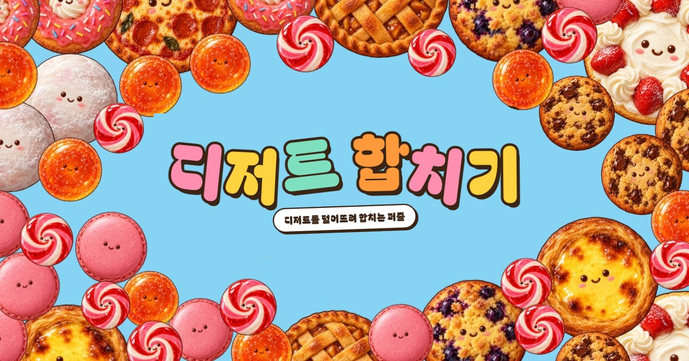
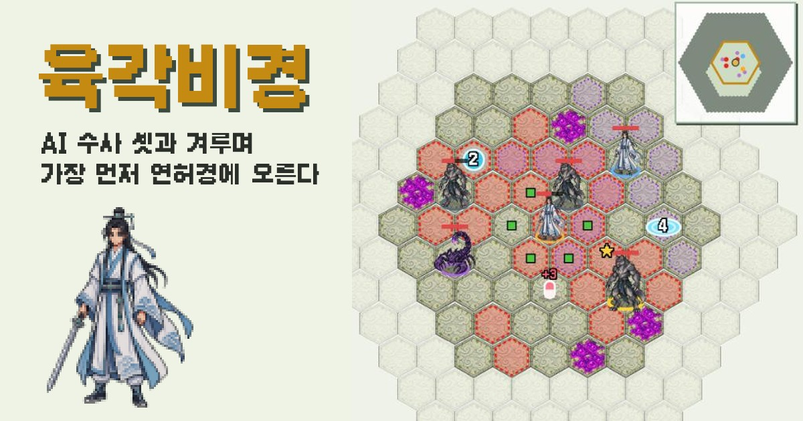

AI 에이전트와 게임을 만들면 "돌아가는 게임"은 금방 나온다. 그런데 돌아가는 게임이 곧 완성된 게임일까. 나는 같은 방식으로 만든 두 게임 가운데 하나는 완성됐다고 느꼈고, 다른 하나는 그렇게 느끼지 못했다. 그 차이가 무엇인지 말하지 못하면, 에이전트에게 무엇을 더 고치라고 할지도 정할 수 없다.

이 글은 그 감각을 에이전트와 함께 말로 옮긴 대화다. 대화는 2026년 10월 13일 오전 11시 7분에 시작해 오후 4시 46분에 끝났다. 흐름을 바꾼 대목만 골라 시간 순서대로 옮긴다. 내 말은 맞춤법과 띄어쓰기만 다듬었다. 에이전트의 답은 원문 문장을 살려 줄이고, 한 절 안에 흩어진 답은 하나로 합쳤다. 절 사이의 짧은 설명은 내가 덧붙였다. 밑줄 친 말을 누르면 글 끝의 [용어 사전](#glossary)으로 간다.

## 두 게임과 등장인물

나(강PD)는 AI 에이전트들과 [하루 게임](#g-daily)을 만든다. 하루 게임은 매일 저녁 방송 전에 작은 게임 하나를 배포까지 마치는 방식이다. 대개 잘 알려진 원작 게임을 작게 줄여서 만든다. 이 대화는 방송 다음 날 한 것이다.

이야기에 나오는 두 게임은 [AI Playground](https://playground.artificialmind.kr/)에서 해 볼 수 있다.

- **디저트 합치기(드롭머지):** 같은 디저트 둘을 합쳐 더 큰 디저트로 만드는 퍼즐이다. 원작 [Suika Game](#g-suika)을 거의 그대로 줄였다. 나는 이 게임이 완성됐다고 느꼈다.
- **육각비경:** 육각 칸으로 된 지도에서 수사(修士)를 움직여 요괴를 피하고 베는 턴제 게임이다. 원작 [Hoplite](#g-hoplite)에 [Vampire Survivors](#g-vs)식 성장을 섞었다. 플레이어는 AI가 움직이는 맞수 수사 셋과도 겨룬다. 한 판은 끝까지 돌지만, 나는 이 게임이 완성됐다고 느끼지 못했다.

  <figure>
    
    <figcaption><strong>디저트 합치기(드롭머지)</strong><em>완성되었다고 느낀 게임</em></figcaption>
  </figure>
  <figure>
    
    <figcaption><strong>육각비경</strong><em>한 판은 돌지만 완성되었다고 느끼지 못한 게임</em></figcaption>
  </figure>

대화 상대는 매니저 에이전트 브로콜리다. 브로콜리는 게임마다 있는 작업 에이전트와 달리, 여러 게임 프로젝트에 두루 쓰이는 [모델](#g-model)과 문서를 맡는다. 모델은 어떤 대상이 어떻게 돌아가는지 설명한 문서이고, 에이전트는 이것을 읽고 판단한다. 게임마다 [계약](#g-contract)이라는 기획 문서도 있다. 작업 에이전트는 계약을 읽고 게임을 만든다. 육각비경은 hex-hop 저장소의 작업 에이전트가 만든다.

## 읽기 전에: MDA

대화는 [MDA 프레임워크](#g-mda) 위에서 오간다. 게임을 메커닉스, 다이내믹스, 에스테틱스 세 층으로 보는 게임 디자인 프레임워크다. 만드는 사람이 직접 손대는 것은 맨 아래 층뿐이고, 플레이어가 느끼는 재미에는 가운데 층을 거쳐서만 닿는다. 디저트 합치기로 예를 들면 이렇다.

  

    
메커닉스 · 만든다<strong>규칙과 조작</strong><em>같은 디저트 둘이 닿으면 합쳐진다</em>

    
다이내믹스 · 드러난다<strong>플레이에서 생기는 움직임</strong><em>상자가 차올라 놓을 자리가 줄어든다</em>

    
에스테틱스 · 느낀다<strong>플레이어가 느끼는 재미</strong><em>연달아 합쳐질 때의 쾌감</em>

  

만드는 사람이 노리는 재미를 [목표 에스테틱스](#g-target)라 부르고, 계약에 순위를 매겨 적는다. 육각비경 계약의 1순위 목표는 수를 읽어 이기는 재미였다.

## 감각을 말로 옮기다

오전 대화는 내 막연한 감각에 이름을 붙이는 데서 시작했다.

### 물음 (11:07)

**강PD** 어제 게임 방송했다. 게임이 어떻게 돌아는 간다. 여러 피드백거리는 찾았지만 근본적인 질문이 생겼다. 게임의 완성도를 어떻게 결정하는가이다. 어느 정도 수준이 되어야 완성되었다고 할 수 있는 걸까? 드롭머지는 완성되었다는 것을 알겠다. 그런데 육각비경은 한 판 플레이는 되지만 완성되었다는 느낌이 없다. 이것에 대한 감각을 가지는 것이 중요할 것 같다. 논의해 보자.

**브로콜리** 지금 하루 게임 모델은 완성을 "배포되어 외부 사용자가 플레이할 수 있는 상태"로 정의합니다. 이건 [출시](#g-release) 기준이지 완성도 기준이 아닙니다. 육각비경은 이 기준을 이미 넘었습니다. 그래서 강PD가 느끼는 "완성되지 않았다"는 감각을 설명할 말이 지금 모델에 없습니다.

가설을 드리면, 완성도는 다섯 층으로 봅니다.

1. 돈다: 한 판이 시작부터 끝까지 오류 없이 간다.
2. 닫힌다: 목표, 위협, 끝, 결과, 다시 할 이유가 한 바퀴로 이어진다.
3. 느껴진다: 1순위 목표 에스테틱스가 플레이에서 실제로 일어난다.
4. 다듬어졌다: 처음 온 사람이 설명 없이 알고, 난이도와 연출이 그 느낌을 받친다.
5. 버틴다: 여러 판을 해도 새로운 수가 나온다.

완성선은 셋째 층입니다. 드롭머지는 원작 Suika Game을 거의 그대로 줄여, 원작의 재미를 빌려 왔습니다. 육각비경은 Hoplite에 Vampire Survivors를 섞어 크게 고쳐서, 이제 새로 설계한 게임입니다. 그래서 육각비경의 재미는 우리가 직접 증명해야 합니다.

하나 묻겠습니다. 강PD가 육각비경을 할 때 "한 수로 위험을 피하면서 머리로 이겼다"는 순간이 있었습니까?

### 업계 용어로 (11:32)

**강PD** 머리로 이겼다는 감각은 없었다. 확실히 게임 특성이 바뀐 듯. 비경을 탐색하고 수집하는 것이 강해졌다. 그리고 다양한 외부 조건에서 싸울지 피할지를 정했다. 이 부분에서 좀 정적인 느낌이 있어서 긴장감이 떨어지는 듯. 턴제 게임이다 보니 유저가 받는 [피드백](#g-feedback)이 제한적인 것 같다. 유저가 게임 안에서 얻는 피드백이 에스테틱스라고 할 수도 있을 것 같다. 피드백의 [강도](#g-intensity)와 주기 같은 것도 감각에 있어야 할 듯.

'머리로 이긴다'라는 표현 말고 업계 전문 용어를 쓰자. 돈다, 닫힌다, 느껴진다, 다듬어졌다, 버틴다. 모두 가능하면 전문 용어를 쓰자.

**브로콜리** 다섯 층을 업계 용어로 옮기면 [Playable](#g-playable), [Core Loop](#g-coreloop) 완결, [Proof of Fun](#g-pof), [Polish](#g-polish), [Replayability](#g-replay)입니다. "머리로 이겼다"는 MDA가 드는 에스테틱스 여덟 가지 가운데 [Challenge](#g-challenge)이고, 그중에서도 전술적 숙련([Tactical Mastery](#g-tactical))에 해당합니다.

강PD의 관찰도 용어로 옮기겠습니다. "탐색하고 수집하는 것이 강해졌다"는 육각비경의 에스테틱스가 Challenge에서 [Discovery](#g-discovery)(탐험)와 수집(Collection)으로 옮겨 간 것입니다. 그런데 육각비경 계약은 아직 Challenge를 1순위 목표로 두고 있으니, 계약의 목표와 실제 플레이가 어긋나 있습니다. "싸울지 피할지를 정했다"는 Sid Meier가 말한 [Interesting Decision](#g-interesting), 그중에서도 [Risk-Reward](#g-riskreward) 선택입니다. 이것은 좋은 재료입니다. "정적이라 긴장감이 떨어진다"는 [Pacing](#g-pacing) 문제입니다. 시간에 따른 긴장의 높낮이를 [Intensity Curve](#g-intensitycurve)라고 하는데, 육각비경은 이 곡선이 평평한 것입니다.

다만 피드백은 에스테틱스 자체가 아니라 에스테틱스로 가는 통로입니다. 통로가 약하면 [다이내믹스](#g-dynamics)가 좋아도 에스테틱스가 생기지 않습니다. 강PD가 말한 강도는 업계에서 [Game Feel](#g-gamefeel)과 [Juice](#g-juice)라고 합니다. 타격 순간 화면을 잠깐 멈추는 Hit Stop, 화면 흔들림, 파티클, 소리처럼 행동 하나에 돌아오는 반응의 크기입니다. 주기는 피드백 루프의 시간 단위로, Moment-to-Moment(초 단위의 행동과 반응), Core Loop(분 단위로 되풀이하는 중심 행동), Meta Loop(판과 판 사이)로 나눕니다. 보상이 나오는 간격은 Reward Schedule이라고 합니다.

턴제가 불리한 이유도 여기서 설명됩니다. Game Feel은 실시간 조작을 전제로 하는데, 턴제에는 그 통로가 없습니다. 그래서 턴제 게임은 다른 데서 긴장을 만듭니다. 한 수의 무게([Stakes](#g-stakes))를 키우거나, 시간이 갈수록 압박을 키우거나([Clock](#g-clock), [Escalation](#g-escalation)), 수의 결과가 터지는 순간에 Juice를 싣습니다. 육각비경은 넓은 맵을 천천히 돌아다니는 구조라, 앞의 둘이 모두 약할 가능성이 큽니다.

### 의미와 피드백 (11:43)

**강PD** 메모리에 남기지 말고 용어 사전이나 모델 같은 문서에 남겨 둬라. 메모리는 언제든지 삭제될 수 있다. Challenge와 '머리로 이겼다'는 매칭이 잘 안 된다. '수 싸움' 정도의 느낌이다. 용어 사전을 잘 활용하자. 우리 프로젝트에서 쓰는 공통언어가 잘 구축되어야 오해를 하지 않는다. 에스테틱스는 피드백들의 결합체로 이해하면 될 듯? 강도와 주기라는 용어는 그대로 쓴다.

육각비경은 턴제의 불리함 때문에 Stakes와 Clock, Escalation 등이 약한 것 같다. 종합해 보면 탐험과 수집은 Stakes와 Clock, Escalation 등과 궁합을 맞추기 어려울지도 모르겠다.

*(메모리는 에이전트가 대화 밖에 따로 적어 두는 기억이다. 브로콜리는 앞서 용어를 쓰기로 한 것을 메모리에 남겼고, 이 말을 듣고 그 항목을 지운 뒤 모델 문서에 옮겼다.)*

**브로콜리** 에스테틱스가 피드백들의 결합체라는 말은 절반은 맞다고 봅니다. 에스테틱스는 피드백을 거쳐서만 플레이어에게 닿습니다. 다만 피드백을 쌓기만 해서는 에스테틱스가 되지 않습니다. 같은 Juice라도 Stakes가 없는 판에서는 그냥 볼거리로 끝납니다. 정리하면, 에스테틱스는 결정이 가진 의미(Stakes, 목표)와 그 결과를 돌려주는 피드백(강도, 주기)을 곱한 것입니다. 육각비경은 지금 두 항이 모두 약합니다. 의미 쪽에서는 Stakes와 Clock이 약하고, 피드백 쪽에서는 턴제라 Game Feel이 약합니다.

궁합은 나쁘지 않다고 봅니다. 오히려 탐험과 수집이 Risk-Reward가 되려면 Stakes와 Clock이 있어야 합니다. 업계에서 검증된 조합이 여럿 있습니다.

| 게임 | 탐험·수집 | Stakes | Clock·Escalation |
| --- | --- | --- | --- |
| [FTL](#g-ftl) | 섹터마다 비콘을 탐험한다 | 배가 부서지면 처음부터 다시 한다 | 반란군 함대가 뒤쫓아 온다 |
| [Spelunky](#g-spelunky) | 층을 뒤져 보물을 줍는다 | 죽으면 처음부터 다시 한다 | 오래 머물면 유령이 나온다 |
| [Extraction](#g-extraction) 장르(Escape from Tarkov 등) | 맵을 뒤져 전리품을 모은다 | 죽으면 모은 것을 잃는다 | 탈출 시간이 정해져 있다 |
| [배틀로얄](#g-br) | 넓은 맵을 돌며 장비를 모은다 | 죽으면 판이 끝난다 | 안전 구역(Zone)이 좁아진다 |

이 게임들에서는 "더 탐험할까, 지금 빠질까"가 곧 Interesting Decision입니다. 탐험이 깊어질수록 잃을 것이 커지고, 남은 시간은 줄어듭니다.

육각비경은 이미 그 뼈대의 절반을 가지고 있습니다. 넓은 맵, 경쟁하는 맞수 셋, 쓰러지면 모은 것을 떨구는 규칙이 있어 구조가 배틀로얄에 가깝습니다. 빠진 것은 Clock입니다. 맵이 턴마다 무너져 바깥이 닫히는 Zone 같은 장치가 없습니다. Stakes도 빠져 있습니다. 쓰러지면 모은 것을 잃는다는 무게가 플레이어에게 느껴지지 않습니다. Clock이 좁혀 오면 수사들이 자연히 만나게 되고 교전이 잦아집니다. 그러면 피드백의 주기가 짧아져, 턴제의 정적인 느낌도 함께 풀 수 있습니다.

육각비경의 방향을 정해 주십시오. 저는 A를 권합니다. 이미 플레이에서 실제로 일어난 쪽이기 때문입니다.

- **A. 탐험과 수집에 Extraction·배틀로얄식 Clock과 Stakes를 더한다.** 1순위는 Discovery, 2순위는 Challenge(Risk-Reward 교전)다.
- **B. Tactical Mastery로 되돌린다.** 맵을 좁히고 정보를 드러내는 Hoplite 쪽으로 돌아간다.

### 방향과 난이도 (11:50)

**강PD** B가 나을 것 같다. A를 증명하기에는 허들이 많을 것 같다. 이미 필드에서 여러 개체를 많이 만나고 있다. 그리고 수집해야 할 것의 중요성도 떨어지고, 다양한 수집품을 만들고 설계하는 것은 복잡도가 높아진다.

게임의 완성도 감각에 난이도가 있어야 하지 않을까. 이것이 에스테틱스에 영향을 미칠 듯.

**브로콜리** B로 정하겠습니다. 강PD가 든 이유에 동의합니다. A가 성립하려면 Discovery를 받칠 수집품의 깊이가 필요한데, 그것을 설계하는 일 자체가 복잡도를 크게 키웁니다.

난이도도 맞습니다. Challenge를 노리는 게임에서는 난이도가 에스테틱스를 직접 정합니다. 업계에서는 [Flow](#g-flow)로 설명합니다. 도전이 실력보다 크면 플레이어는 불안해지고, 작으면 지루해집니다. 둘 사이의 좁은 띠 안에 있을 때만 Challenge가 일어납니다.

육각비경에서는 강PD가 두 번째로 플레이했을 때 "갑자기 너무 어려워졌다"는 반응이 나왔습니다. 그런데 육각비경의 난이도는 시험용 봇끼리 48판을 두게 하고 그 승률로 맞췄습니다. 봇의 승률은 사람이 몰입하는지를 말해 주지 않습니다. 진 플레이어가 진 까닭을 자기 수에서 찾을 수 있는지([Fairness](#g-fairness))도 아직 아무도 보지 않았습니다. 안개 때문에 시야 밖에서 맞수가 나타나 지면, 플레이어는 진 까닭을 알 수 없습니다.

B를 고르면 난이도가 저절로 맞물립니다. Hoplite가 본보기입니다. 체력이 적어 한 수의 실수가 치명적이고(Stakes), 층을 내려갈수록 적이 많아지고 세지며(Escalation, 곧 판이 진행되며 난이도가 오르는 Difficulty Curve), 적의 공격 범위를 다 보여 주어([Telegraph](#g-telegraph)) 지면 내 수 탓입니다(Fairness). 이 셋이 겹친 결과가 Tactical Mastery입니다. 그러니 B로 가면, 정보를 가리는 넓은 맵과 안개를 걷어 내고 판을 층 단위로 나누는 쪽으로 고칠 방향이 분명해집니다. 드롭머지가 완성되었다고 느껴지는 까닭도 같은 틀로 설명됩니다. 상자가 차오르면서 Difficulty Curve가 저절로 생기고, 넘친 까닭이 눈에 보여 Fairness도 갖춰져 있습니다.

### 누가 정하는가 (11:54)

**강PD** 육각비경을 B로 돌리는 등 세부 결정은 해당 프로젝트 작업자가 결정할 일이다. 우리는 모델링 작업을 하고 이슈를 전달하면 된다. 그리고 시각적 스타일과 마감도 감성에 영향을 주지 않을까?

**브로콜리** 알겠습니다. 육각비경을 어느 쪽으로 돌릴지는 hex-hop 작업 에이전트가 정하고, 저는 모델을 짜서 그 모델을 담은 이슈만 넘기겠습니다. 앞서 B로 정하겠다고 한 말은 거두겠습니다.

시각적 스타일과 마감은 완성도에 영향이 큽니다. 업계에서는 시각적 스타일을 두 가지로 나눠 봅니다. [Visual Clarity](#g-clarity)(Readability)는 위협과 결과를 한눈에 읽게 하는 것입니다. 이것은 장식이 아니라 Fairness와 피드백을 받치는 통로입니다. 공격 범위가 잘 안 보이면 Tactical Mastery가 운으로 바뀝니다. [Art Direction](#g-artdir)의 일관성([Cohesion](#g-cohesion))은 그림, UI, 소리, 글꼴이 한 세계에서 나온 것처럼 맞는 정도입니다. 하나라도 어긋나면 플레이어는 "덜 만들었다"고 느낍니다.

마감은 업계에서 Polish라고 합니다. 화면 전환, 빈 상태, 메뉴, 소리 같은 거친 곳을 다듬는 일입니다. 사람들은 완성도를 먼저 이 표면으로 판단합니다(Perceived Quality). 드롭머지는 디저트라는 한 세계로 그림, 소리, 말투가 맞춰져 있습니다. 육각비경은 그림을 여러 번 다시 그려서 일관성이 흔들렸을 수 있습니다.

## 외부 리뷰가 뒤집은 것

브로콜리는 여기까지 배운 것을 여섯 가지로 정리해, 나에게 하나씩 합의를 받으려 했다. 나는 그 전에 [외부 리뷰](#g-review)부터 받으라고 했다. 브로콜리는 같은 안을 GPT-6.1 Sol과 Claude Fable 5.1에게 따로 검토받았다.

### 틀린 진단 (12:05)

**강PD** 일단 전반적으로 외부 리뷰를 돌리고, 내가 하나씩 검토하겠다.

**브로콜리** 두 리뷰가 돌아왔습니다. 먼저 제가 틀린 진단을 바로잡겠습니다.

"육각비경은 Clock과 Escalation이 약하다"는 제 말은 계약과 맞지 않습니다. 육각비경 계약에는 이미 Escalation이 있습니다. 몬스터가 15턴마다 늘어 최대 40마리가 됩니다. 장치가 없는 것이 아니라, 있는데 플레이어에게 느껴지지 않는 것입니다.

"턴제라 피드백이 불리하다"는 말도 약합니다. Hoplite, [Into the Breach](#g-itb), 체스는 화려한 [연출](#g-staging)이 거의 없어도 수 싸움이 일어납니다. 리뷰는 원인을 [결정의 밀도](#g-density)와 Stakes로 봅니다. 육각비경은 맵이 넓어서(가운데에서 가장자리까지 15칸, 시야는 4칸) 대부분의 턴이 결정 없는 걷기가 됩니다. 맞수가 다음에 할 일을 칸에 칠해 보여 주지 않아, 플레이어가 맞수의 수를 읽을 수 없습니다. 단약, 호신강기, 흡혈처럼 버티게 해 주는 수단이 많아 한 수의 무게도 작습니다.

제가 처음 낸 다섯 층을 고정된 순서로 본 것도 버려야 합니다. 드롭머지는 1순위 목표가 감각의 재미([Sensation](#g-sensation))라서, Polish에 속하는 Juice 다듬기가 곧 재미를 증명하는 일이었습니다. 다섯 층을 순서 없는 확인 항목으로 바꾸기를 권합니다.

**강PD** 동의.

### 1차 완성 (12:14)

**브로콜리** 완성을 이렇게 다시 썼습니다. 출시는 배포되어 외부 사용자가 플레이할 수 있는 상태입니다. 완성은 그때 계약이 정한 목표 에스테틱스가 대상 플레이어의 플레이에서 일어나는 상태입니다.

정할 것이 둘 있습니다. 첫째, 계약에 적은 목표 가운데 어디까지 일어나야 완성인가. 둘째, 대상 플레이어는 누구인가. 저는 목표 전부, 그리고 처음 온 사람을 권합니다. 규칙을 아는 제작자에게 일어난 경험이 처음 온 사람에게도 일어난다는 보장은 없습니다.

**강PD** 둘 다 권한 안대로 한다. 일단 내가 경험하면 [1차 완성](#g-first)이다.

## 피드백, 난이도, 그리고 계약

다음 항목은 피드백이었다. 브로콜리는 리뷰를 받아, 피드백을 "다이내믹스 가운데 플레이어가 지각하는 면"으로 정의하고 강도와 주기로 재자고 했다.

### 기다리는 동안 (12:31)

**강PD** 피드백 사이의 긴장감? 즉 피드백이 없는 상태, 또는 피드백을 기다리는 상태도 포함시켜야 할까?

**브로콜리** 포함시켜야 합니다. 피드백이 없는 간격은 두 가지로 갈립니다. 결과가 불확실하고 걸린 것이 있으면 [Suspense](#g-suspense)이고, 걸린 것이 없거나 결과가 뻔하면 [Dead Time](#g-deadtime)입니다. 드롭머지에서 떨어뜨린 디저트가 구르다 멈추기를 지켜보는 순간은 Suspense입니다. 육각비경에서 결정 없이 걷는 턴은 Dead Time입니다. 같은 1초라도 무엇이 걸려 있느냐에 따라 긴장이 되기도 하고 지루함이 되기도 합니다. 히치콕이 든 '탁자 밑 폭탄'과 같은 원리입니다. 탁자 밑에 폭탄이 있다는 것을 관객이 알면, 아무 일 없는 대화 장면도 긴장이 됩니다. 게임에서는 Telegraph가 이 역할을 합니다.

이어서 난이도를 다뤘다. 브로콜리는 "도전이 실력과 맞으면 Flow가 일어나기 쉽다", "난이도는 사람의 플레이로 정하고, 봇은 막히는 곳을 찾는 데 쓴다"는 안을 냈다.

### 정량 기준 (12:37)

**강PD** 'Flow'는 몰입을 말하는 거지? 앞으로 '몰입(flow)'이라고 해라. 난이도는 사람의 플레이로도 정할 수 있지만, 어느 정도 정량 기준이 있어야 한다.

**브로콜리** 네, 몰입을 말합니다. 다만 "승률 몇 %가 정답"이라는 업계 공통값은 없습니다. 업계는 지표를 정하고, 게임마다 목표 범위를 둡니다. 예를 들어 Candy Crush 같은 퍼즐 게임은 레벨마다 깨기까지 걸린 시도 횟수와 그 레벨에서 떠난 비율을 보고 레벨을 고칩니다.

우리 게임에 맞는 지표는 이렇습니다. 사람의 플레이에서는 승률, 판의 길이, 끝난 지점의 분포(특정 구간에서 갑자기 많이 지는 Difficulty Spike가 있는가), 진 뒤에 다시 하는 비율을 봅니다. 봇으로는 강한 봇과 약한 봇의 승률 차, 곧 실력 격차를 잽니다. 차가 클수록 운보다 실력이 결과를 정합니다. 목표 범위의 처음 값은 게임의 성격에서 출발합니다. 육각비경은 넷이 겨루는 경주라서, 실력이 같으면 승률이 25%입니다.

다섯째 항목은 시각과 소리였다. 새 게임이 출발하는 템플릿의 계약 규칙은 "그림, 소리, 연출의 값은 코드에 둔다"고 적고 있었다.

### 모두 계약에 (12:39)

**브로콜리** 무엇을 언제 보이고 들려주는가는 플레이어의 선택을 바꾸니 계약에 적고, 색이나 크기, 소리 파일 같은 값은 지금처럼 코드에 두기를 제안합니다.

**강PD** 아니야. 게임 완성도에 영향을 미치는 요인들은 계약에 있어야 한다.

**브로콜리** 알겠습니다. 완성도에 영향을 주는 요인은 모두 계약에 둡니다. Visual Clarity, 피드백의 강도와 주기, Art Direction, 소리, 난이도의 목표 범위입니다. 그림 파일과 소리 파일 자체는 계약에 넣을 수 없으니, 계약은 파일의 자리를 가리키고 그 파일이 지킬 기준을 적습니다.

### 원작이 빌려 주는 것 (13:01)

여섯째 항목은 원작이었다. 하루 게임은 원작을 줄여 만들기 때문에, 원작에서 무엇을 가져오는지가 완성까지 남은 길을 정한다.

**브로콜리** 원작이 빌려 주는 것은 메커닉이 아니라 재미를 나르는 다이내믹스입니다. 육각비경은 Hoplite의 메커닉은 지켰지만, 재미를 나르던 다이내믹스(작은 판, 다 보이는 정보, 빠듯한 체력)를 바꿨습니다.

**강PD** 원작은 메커닉과 다이내믹스 둘 다 빌려 주는 거 아닌가?

**브로콜리** 맞습니다. 제 표현이 틀렸습니다. 원작은 [메커닉스](#g-mechanics)와 콘텐츠, 그리고 그것이 낳는 다이내믹스를 함께 빌려 줍니다. 재미의 증명은 그 조합에 붙어 있습니다. 육각비경은 움직이며 베기와 위험 칸이라는 메커닉은 지켰지만, 함께 맞물려 있던 판의 크기, 시야, 체력 값을 바꿨고 안개와 성장도 더했습니다. 그러자 같은 메커닉이 다른 다이내믹스를 낳았습니다.

## 모델로 정리하다

여섯 항목을 합의한 뒤, 브로콜리는 합의한 용어와 뜻을 모델 문서의 개념 표에 정리했다.

### 용어 40개 (13:06)

**브로콜리** 합의한 대로 개념 표를 37행으로 정리했습니다. Game Feel은 "실시간 조작과 반응, 공간, 연출이 어울려 주는 손맛"으로 적었습니다.

**강PD** Game Feel을 손맛으로 표현하는 건 적절치 않다. 굳이 정의하지 않아도 되는 일반 용어는 넣을 필요 없다.

**브로콜리** 우리가 지었거나 뜻을 좁힌 말만 남겼습니다. Game Feel은 합의한 관계 어디에도 쓰이지 않아 뺐습니다. Juice, Pacing, Difficulty Curve 같은 열일곱 개는 개념 표에 넣지 않고 일반 용어로 쓰겠습니다.

**강PD** 그 열일곱 개도 모두 있어야 할 것 같다. … 하위 모델을 만드는 건 어때? 하나의 모델에 개념이 40개나 들어가는 건 너무 많다.

브로콜리는 모델을 다섯으로 나누는 안을 냈고, 나는 외부 리뷰를 받아 보고 정하겠다고 했다.

**브로콜리** 두 리뷰가 갈렸습니다. Fable은 하나로 두자고 했고, Sol은 넷으로 나누자고 했습니다. 저는 Sol의 안을 권합니다. 넷으로 나누는 안이 "용어는 모두 있어야 한다"와 "한 모델에 40개는 많다"라는 강PD의 두 판단을 함께 지킵니다. 넷은 피드백과 페이싱, 선택과 도전, 표현, 그리고 그 셋을 묶는 완성도입니다.

**강PD** 솔의 네 모델로 정한다.

**브로콜리** 하나 더 정할 것이 있습니다. MDA의 세 층을 저장소마다 다르게 부르고 있습니다. 제가 일하는 워크스페이스 저장소는 메커닉스·다이내믹스·에스테틱스라고 쓰고, 새 게임이 출발하는 템플릿 저장소는 메커닉·동역학·미학이라고 씁니다. 업계에서 쓰는 말로 통일하기를 권합니다.

**강PD** 메커닉스, 다이내믹스, 에스테틱스로 통일.

## 오후: 계약과 코드

오후 2시 반 무렵 대화가 길어져 맥락이 압축되었다. 오후에 브로콜리는 합의한 모델을 문서로 쓰고, 새 게임이 출발하는 템플릿 저장소인 [게임 베이스](#g-base)에 들였다. 그러다 완성도에 영향을 주는 요인을 계약의 어느 칸에 둘지 정하는 대목에서, 내가 상수 관리를 꺼냈다.

### 한 곳만 고치면 (16:00)

**강PD** 음 주요 수치나 문구 등 상수? 관리 체계가 있는 게 좋을 듯.

**브로콜리** 업계에서는 이것을 데이터 주도 설계(data-driven design)라고 부릅니다. 상수를 코드 곳곳에 흩지 않고 정해진 자리에 모아, 기획 쪽이 코드를 몰라도 고칠 수 있게 하는 방식입니다. 보통 수치는 튜닝 값 파일에, 문구는 문자열 테이블(string table)에 둡니다. 수치는 계약의 값(`values`)을 원본으로 삼고, 코드에서는 값 파일(`src/game/values.ts`) 한 곳에 모아, 기계가 둘이 같은지 맞대 보게 하기를 권합니다.

**강PD** 계약의 values가 기계적으로 src/game/values.ts로 변환되는 건 어때? 그러니까 여러 곳을 고치지 말고 하나만 고치면 그 변화가 전파되는 시스템인 거지. string이나 다른 고정 값들은 그렇게 처리하면 좋을 듯. 의견 줘.

**브로콜리** 찬성합니다. 업계에서도 흔한 방식입니다. 기획자가 데이터 테이블을 고치면 도구가 그것을 코드나 데이터로 뽑아내고, 뽑은 파일은 사람이 손대지 않습니다. 값이 한 곳에만 있으니 어긋날 수가 없습니다. 검사는 "만든 파일이 최신인가" 하나만 봅니다. 다만 문구를 계약에 두면 오탈자 하나를 고칠 때도 강PD의 승인을 받아야 합니다. 그래서 문구도 원본을 하나로 두되, 계약이 아니라 테마의 문자열 테이블에 두기를 권합니다.

**강PD** 동의.

템플릿에 들일 계약에는 Art Direction을 적는 칸도 새로 두기로 했다. 그런데 브로콜리가 그 칸을 정리하면서, 합의한 요소 하나를 다른 것으로 바꿔 적었다.

### 연출 (16:33)

**브로콜리** 합의한 모델은 Art Direction을 그림, 소리, UI, 글꼴로 정의합니다. 그런데 제가 계약 칸을 옮기면서 글꼴 대신 연출을 적었습니다. 모델대로 넷으로 둘지, 연출을 더해 다섯으로 둘지 정해 주십시오. 저는 모델대로 넷을 권합니다.

**강PD** 연출에 대해서 더 설명하라.

**브로콜리** 연출은 게임 안에서 일어난 일을 시간 위에서 어떻게 보여 주고 들려주는가입니다. 업계에서는 이펙트(VFX), 화면 흔들림, 카메라, 전환, Hit Stop, 등장과 퇴장, 컷신을 묶어 연출이라고 부릅니다. 연출의 설계값(화면 흔들림 8px, 드롭머지에서 합쳐진 디저트가 기쁜 얼굴로 있는 1.2초)은 계약의 값이 맡고, 강도와 주기는 피드백 모델이 맡습니다. 그런데 연출의 결, 곧 통통 튀고 가벼운지 묵직하고 절제되었는지는 어디에도 담기지 않습니다. 그래서 권하는 안을 바꿔, 연출을 더해 다섯 요소로 두기를 권합니다.

**강PD** 연출은 상위 개념 같다.

**브로콜리** 맞습니다. 연출은 그림, 소리, UI, 글꼴을 시간 위에 엮어서 일어난 일을 전하는 일 전체입니다. 나란히 놓을 요소가 아니라 그것들을 아우르는 개념입니다. 그러면 제가 "연출의 결"이라고 부른 빈자리는 정확히는 [모션](#g-motion)입니다. 이펙트, 흔들림, 전환이 움직이는 결이고, 업계에서도 모션이나 VFX로 따로 다룹니다. Art Direction은 그림, 소리, UI, 글꼴, 모션 다섯으로 두겠습니다.

**강PD** 그래.

## 덧붙임

이날 합의한 것은 모델 문서 넷(피드백과 페이싱, 선택과 도전, 표현, 완성도)이 되었고, 템플릿 저장소에도 들어갔다. 육각비경을 어디로 돌릴지는 hex-hop 작업 에이전트에게 이슈로 넘겼다. 그 이슈를 받아 육각비경을 다시 짠 과정은 [다음 대담](/ko/posts/hex-hop-redesign-dialogue/)에 있다.

대화의 원문은 시간 순서대로 파일에 남겼고, 이 글은 그 원문을 다시 줄인 것이다. 줄이면서 보니 대화의 모양이 하나 보였다. 브로콜리는 빠르게 가설과 용어를 내놓았고, 나는 그 말이 내 감각과 맞지 않는 곳을 짚었다. 둘 다 그럴듯하다고 믿은 진단은 외부 리뷰가 계약 파일과 대조해 뒤집었다. 모델은 그 셋이 서로 바로잡은 자리에서 나왔다.

<section class="gq-glossary" id="glossary">
<h2>용어 사전</h2>

본문에서 밑줄 친 말을 누르면 이곳으로 온다. 뜻은 이 대화와 그 뒤에 정리한 모델을 따랐다.

<h3>게임 설계의 틀</h3>
<dl>
<dt id="g-mda">MDA 프레임워크</dt><dd>게임을 메커닉스(mechanics), 다이내믹스(dynamics), 에스테틱스(aesthetics) 세 층으로 보는 게임 디자인 프레임워크. Hunicke, LeBlanc, Zubek의 2004년 논문에서 나왔다.</dd>
<dt id="g-mechanics">메커닉스(mechanics)</dt><dd>게임의 규칙과 플레이어가 쓸 수 있는 조작. 예: 같은 디저트 둘이 닿으면 합쳐진다.</dd>
<dt id="g-dynamics">다이내믹스(dynamics)</dt><dd>규칙이 실제 플레이에서 만들어 내는 움직임. 예: 상자가 점점 차올라 놓을 자리가 줄어든다.</dd>
<dt id="g-target">목표 에스테틱스</dt><dd>만드는 사람이 노리는, 플레이어가 느낄 재미. 여럿이면 순위를 매긴다. MDA는 Sensation, Fantasy, Narrative, Challenge, Fellowship, Discovery, Expression, Submission 여덟 가지를 예로 든다.</dd>
</dl>
<h3>재미의 종류</h3>
<dl>
<dt id="g-challenge">Challenge</dt><dd>어려움을 이겨 내는 재미.</dd>
<dt id="g-discovery">Discovery</dt><dd>새로운 곳이나 것을 찾아내는 재미.</dd>
<dt id="g-sensation">Sensation</dt><dd>보고 듣고 손으로 느끼는 감각의 재미.</dd>
<dt id="g-tactical">Tactical Mastery</dt><dd>수를 읽고 두어 상대나 상황을 앞서는 재미. 강PD가 말한 '수 싸움'을 가리키려고 고른 말이며, 업계 표준 분류는 아니다.</dd>
</dl>
<h3>완성도</h3>
<dl>
<dt id="g-release">출시</dt><dd>배포되어 누구나 플레이할 수 있는 상태.</dd>
<dt id="g-first">1차 완성</dt><dd>만든 사람(강PD)의 플레이에서 목표 에스테틱스가 모두 일어난 상태. 처음 온 사람에게서도 일어나야 완성이다.</dd>
<dt id="g-playable">Playable</dt><dd>한 판이 처음부터 끝까지 오류 없이 도는 상태.</dd>
<dt id="g-coreloop">Core Loop</dt><dd>플레이어가 되풀이하는 중심 행동의 한 바퀴. 예: 디저트를 떨어뜨리고, 합치고, 다음 디저트를 받는다.</dd>
<dt id="g-pof">Proof of Fun</dt><dd>노린 재미가 실제 플레이에서 일어나는지 확인하는 일.</dd>
<dt id="g-polish">Polish</dt><dd>거친 곳을 다듬어 경험을 매끄럽게 하는 일. 마감이라고도 한다.</dd>
<dt id="g-replay">Replayability</dt><dd>여러 판을 해도 다시 할 거리가 남는 성질.</dd>
</dl>
<h3>피드백과 흐름</h3>
<dl>
<dt id="g-feedback">피드백</dt><dd>게임에서 일어난 일 가운데 플레이어가 보고 듣고 느끼는 면.</dd>
<dt id="g-intensity">강도와 주기</dt><dd>강도는 피드백 하나의 크기이고, 주기는 피드백이 돌아오는 간격이다.</dd>
<dt id="g-gamefeel">Game Feel</dt><dd>실시간 조작과 그 반응, 공간, 연출이 어우러져 주는 느낌. Steve Swink의 같은 이름의 책에서 온 말이다.</dd>
<dt id="g-juice">Juice</dt><dd>행동의 결과를 크고 풍성하게 보여 주는 연출. 번쩍임, 흔들림, 소리 같은 것이다.</dd>
<dt id="g-suspense">Suspense</dt><dd>무언가 걸린 결과를 기다리는 동안의 긴장.</dd>
<dt id="g-deadtime">Dead Time</dt><dd>걸린 것도, 기다릴 결과도 없는 빈 시간.</dd>
<dt id="g-telegraph">Telegraph</dt><dd>다음에 올 위협이나 결과를 미리 보여 주는 것. 예: 적이 다음 턴에 칠 칸을 붉게 칠한다.</dd>
<dt id="g-pacing">Pacing</dt><dd>한 판 안에서 긴장이 오르내리는 흐름.</dd>
<dt id="g-intensitycurve">Intensity Curve</dt><dd>한 판의 긴장 강도를 시간 축에 그린 것. 오르내림이 없이 평평하면 판이 정적으로 느껴진다.</dd>
<dt id="g-clock">Clock</dt><dd>시간이나 진행에 따라 차오르며 플레이어를 몰아붙이는 장치. 예: 배틀로얄에서 좁아지는 안전 구역(Zone).</dd>
<dt id="g-escalation">Escalation</dt><dd>판이 진행될수록 위협이 커지는 것. 예: 육각비경에서 15턴마다 늘어나는 몬스터.</dd>
</dl>
<h3>결정과 난이도</h3>
<dl>
<dt id="g-stakes">Stakes</dt><dd>한 결정으로 얻거나 잃을 수 있는 것과 그 무게.</dd>
<dt id="g-riskreward">Risk-Reward</dt><dd>위험을 더 지는 대신 더 얻는 선택.</dd>
<dt id="g-interesting">Interesting Decision</dt><dd>정답이 하나로 정해지지 않아 절충을 따져야 하는 선택. 게임 디자이너 Sid Meier가 쓴 말이다.</dd>
<dt id="g-density">결정의 밀도</dt><dd>한 판에서 의미 있는 결정이 오는 빈도.</dd>
<dt id="g-flow">Flow, 몰입(flow)</dt><dd>도전과 실력이 맞아 활동에 빠져드는 상태. 심리학자 Csikszentmihalyi의 이론이고, 게임 쪽에서는 Jenova Chen의 "Flow in Games"가 이어받았다. 대화 중에 강PD가 '몰입(flow)'으로 부르기로 정했다.</dd>
<dt id="g-fairness">Fairness</dt><dd>진 사람이 왜 졌는지 알고, 대응할 기회가 있었는지의 정도.</dd>
</dl>
<h3>표현</h3>
<dl>
<dt id="g-clarity">Visual Clarity / Clarity</dt><dd>선택에 필요한 정보와 그 결과를 보고 듣고 알아볼 수 있는 정도. Readability라고도 한다. 소리까지 맡게 되어, 이 대화 중에 이름을 Clarity로 바꿨다.</dd>
<dt id="g-cohesion">Cohesion</dt><dd>그림, 소리, UI, 글꼴, 모션이 한 세계에서 나온 듯 맞는 정도.</dd>
<dt id="g-artdir">Art Direction</dt><dd>그림, 소리, UI, 글꼴, 모션의 방향을 함께 정한 것.</dd>
<dt id="g-staging">연출</dt><dd>그림, 소리, UI, 글꼴, 모션을 시간 위에 엮어 게임 안에서 일어난 일을 플레이어에게 전하는 일.</dd>
<dt id="g-motion">모션(motion)</dt><dd>이펙트, 흔들림, 화면 전환이 움직이는 결. 통통 튀는지, 묵직한지가 여기서 갈린다.</dd>
</dl>
<h3>우리 작업 방식</h3>
<dl>
<dt id="g-daily">하루 게임</dt><dd>매일 저녁 7시 방송 전에 작은 게임 하나를 배포까지 마치는 방식.</dd>
<dt id="g-model">모델</dt><dd>어떤 대상이 어떻게 돌아가는지 설명하는 문서. 에이전트와 사람이 함께 읽고 판단할 때 쓴다.</dd>
<dt id="g-contract">계약</dt><dd>게임의 목표 에스테틱스, 다이내믹스, 메커닉스와 그 값을 적은 기획 문서. 작업 에이전트가 이것을 읽고 게임을 만든다.</dd>
<dt id="g-review">외부 리뷰</dt><dd>같은 안을 다른 AI 모델 둘에게 따로 검토받는 일.</dd>
<dt id="g-base">게임 베이스</dt><dd>하루 게임이 새 게임을 만들 때 출발하는 템플릿 저장소.</dd>
</dl>
<h3>이야기에 나오는 게임</h3>
<dl>
<dt id="g-suika">Suika Game</dt><dd>과일을 떨어뜨려 같은 것끼리 합치는 물리 기반 머지 퍼즐(2021). 디저트 합치기의 원작이다.</dd>
<dt id="g-hoplite">Hoplite</dt><dd>육각 격자에서 하는 턴제 로그라이크. 판마다 맵이 바뀌고, 죽으면 처음부터 다시 한다. 적의 공격 범위가 모두 보이고 체력이 적어, 한 수 한 수가 수 싸움이 된다. 육각비경의 원작이다.</dd>
<dt id="g-vs">Vampire Survivors</dt><dd>자동 공격과 레벨업 성장을 중심으로 한 생존 액션 게임. 비슷한 게임들을 묶어 '뱀서라이크'라고 부를 만큼 장르를 만들었다.</dd>
<dt id="g-itb">Into the Breach</dt><dd>적이 다음 턴에 칠 곳을 미리 보여 주는(Telegraph) 턴제 전술 게임. 한 수의 실수가 치명적이다.</dd>
<dt id="g-ftl">FTL: Faster Than Light</dt><dd>우주선을 몰고 섹터를 건너는 로그라이크. 배가 부서지면 그 도전이 끝나고 처음부터 다시 한다.</dd>
<dt id="g-spelunky">Spelunky</dt><dd>동굴을 내려가며 보물을 줍는 로그라이크 플랫포머. 죽으면 처음부터 다시 한다.</dd>
<dt id="g-extraction">Extraction 장르</dt><dd>맵에서 전리품을 모아 정해진 시간 안에 탈출(extraction)해야 하는 게임. 죽으면 모은 것을 잃는다. Escape from Tarkov가 대표작이다.</dd>
<dt id="g-br">배틀로얄(battle royale)</dt><dd>여럿이 넓은 맵에서 장비를 모으며 마지막 하나가 남을 때까지 싸우는 장르. 시간이 갈수록 안전 구역(Zone)이 좁아진다.</dd>
</dl>
</section>
