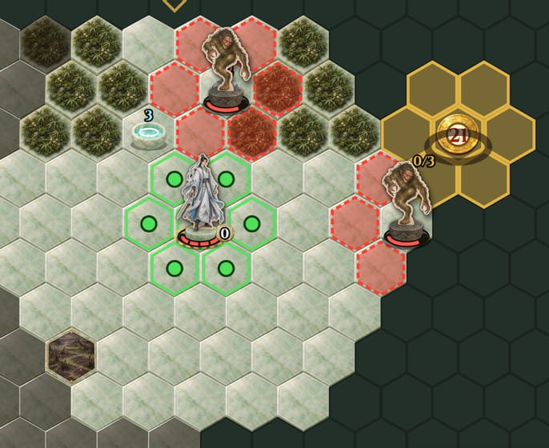

나는 강PD이고, AI 에이전트들과 육각비경이라는 게임을 만든다. 육각 칸으로 된 지도 위에서 차례를 번갈아 두는 턴제 보드게임이다. 플레이어는 [수사](#g-susa)(修士, 도를 닦는 사람) 하나를 움직여, AI가 움직이는 수사 셋과 겨룬다. 수사는 차례마다 한 칸 움직이거나, 상대를 치거나, 스킬을 쓴다. 지도에는 게임이 움직이는 요괴들이 돌아다닌다. 한 판은 몇 분이면 끝난다.

  <figure>
    
    <figcaption><strong>이 글을 쓸 때의 육각비경</strong><em>가운데가 플레이어의 수사다. 초록 점은 갈 수 있는 칸, 붉은 칸은 요괴가 칠 칸, 오른쪽 위의 금빛 칸은 거점이다</em></figcaption>
  </figure>

이기는 길은 경주였다. 지도에서 거점이 미리 예고된 뒤 하나씩 열린다. 열린 거점의 둘레에 정해진 턴 동안 머물러 점령한 수사는 인장을 얻는다. 인장 3개를 모아 지도 가장자리의 출구에 먼저 닿은 수사가 이긴다. 그 사이 요괴가 돌아다니며 수사를 치고, 체력이 다한 수사는 쓰러진다. 쓰러진 수사의 인장은 그 자리에 떨어져 다른 수사가 주울 수 있다. 내가 노린 것은 이런 긴장이었다. 맞수가 인장을 먼저 모아 출구로 가면 막아야 하고, 나도 서두르다 쓰러지면 끝이다. 이 글에서는 이것을 '인장 경주', 줄여서 '경주'라고 부른다.

그런데 실제로 해 보니 이 긴장이 잘 일어나지 않았다. 2026년 10월 17일, 나는 경주를 살리려고 에이전트와 하루를 썼다. 인장의 공급을 늘리고, 얻는 법을 바꾸고, 출구를 옮겼다. 규칙을 통째로 다시 짜 보기도 했다. 그래도 경주는 살아나지 않았다. 값을 아무리 고쳐도 풀리지 않는 문제는 어디에 원인이 있을까.

이 글은 그날과 이튿날의 기록이다. 앞의 절반은 내가 둔 두 판에서 시작해 "경주는 이 형식에서 성립하지 않는다"는 결론에 이르기까지의 흐름이다. 뒤의 절반은 그 까닭을 앞선 [대담](/ko/posts/hex-hop-game-model-dialogue/)에서 세운 [게임 모델](#g-gamemodel)에 비추어 따져 본 분석이다. 측정과 분석은 육각비경 저장소를 맡은 에이전트가 했고, 에이전트가 남긴 기록 문서를 내가 고쳐 옮겼다. 분석 가운데 에이전트의 짐작인 것은 그렇다고 밝혔다. 따옴표 안의 내 말은 맞춤법과 띄어쓰기만 다듬었다. 밑줄 친 말을 누르면 글 끝의 [용어 사전](#glossary)으로 간다.

## 이 글에서 쓰는 말

- **판과 지도:** '판'은 게임을 처음부터 끝까지 한 번 하는 것이다. 게임이 펼쳐지는 육각 칸의 바닥은 '지도'라고 부른다.
- **맞수:** 플레이어와 겨루는 AI 수사다. 맞수는 [Jev](#g-jev)라는 선택 모델로 수를 고른다.
- **AI 판:** 여러 판을 빠르게 돌릴 때는 정해진 규칙대로 두는 [대역](#g-bot)이라는 봇이 플레이어 자리까지 네 자리를 모두 맡는다. 이렇게 둔 판을 'AI 판'이라고 부른다.
- **목표 에스테틱스:** 나는 게임마다 플레이어가 느낄 재미를 [목표 에스테틱스](#g-target)로 먼저 정해 둔다. 경주는 육각비경의 목표 가운데 순위가 셋째인 [race-on-the-edge](#g-race), 곧 "쓰러지면 끝인데 늦으면 진다"는 긴장을 노린 것이었다.

이 글은 [사건 척도 대담](/ko/posts/hex-hop-drama-scale-dialogue/)에서 이어진다. 그 대담에서 판 하나 안의 사건을 크기별로 쟀다. 사건은 잇달아 일어난 변화(맞음, 쓰러짐, 인장의 이동 같은 것)의 묶음이고, 묶인 변화의 수가 사건의 크기다.

## 가장 큰 장면이 생각만큼 크지 않았다

10월 17일 나는 그때 배포한 게임으로 두 판을 했고, 둘 다 출구로 이겼다. 두 번째 판의 68~72턴에 이런 일이 있었다. 나는 인장 3개를 모은 맞수 하나의 길목을 막았다. 그 맞수는 [정예 요괴](#g-elite)의 강타를 맞고 쓰러졌고, 나는 떨어진 인장 3개를 한 번에 주웠다.

그 장면을 두고 나는 이렇게 말했다.

> "사실 이 게임에서 나올 수 있는 가장 큰 사건 중에 하나라고 본다. 그러나 인간 입장에서는 임팩트가 그 정도로 크게 느껴지지는 않았다."

임팩트가 없지는 않았지만, 그만한 사건이라면 느껴졌어야 할 만큼 크지는 않았다. 나는 그 까닭을 이렇게 짚었다.

> "임팩트가 크게 느껴지지 않은 것은 인장의 값어치가 크게 느껴지지 않았기 때문이다. 게임 자체가 인스턴틀리한 몇 분 남짓한 게임이고 게임 내 선택들의 무게도 크지 않기 때문이다."

아쉬운 것이 둘 더 있었다. 맞수가 내 길막음을 피하려고 정예의 공격 범위로 뛰어든 것은 지능적인 수가 아니었다. 그리고 다른 맞수들이 이미 다 쓰러져 있어서, 큰일 뒤에 판이 그냥 끝났다.

## 인장의 값어치

에이전트는 인장의 값어치를, 인장을 얻는 데 든 품에서 찾았다. 나는 그렇게 보지 않았다.

> "인장이 정말 중요한 것이라면 거저 와도 좋아야 한다. 공짜로 로또 맞았다고 그 값어치가 줄어드는 게 아니잖아. 게임이라는 맥락 안에서 해당 요소가 값어치를 지녀야 한다는 거다."

그리고 이렇게 정했다.

> "인장은 레이스의 핵심 요소이다. 그런데 값어치가 안 느껴진다면 레이스 자체에 문제가 있다고 봐야 할 듯. 이 문제가 육각비경 게임 완성도의 핵심 질문이다."

에이전트는 이 물음 하나로 [실험 이슈](#g-experiment)를 열었다. 쓰러질 칸으로 걸어 들어간 맞수의 수는 지능 결함으로 보고 따로 고치기로 했다.

## 경주를 재다

에이전트가 AI 판 200개로 경주가 어떤 모습인지 쟀다.

- 두 수사가 동시에 인장 2개 이상을 쥔 판은 11%다.
- 선두는 판마다 0.5번 바뀌었다.
- 인장 3개에 닿은 수사의 78%가 그대로 이겼다. 닿은 뒤 출구까지는 중앙값 19턴이 걸렸다.
- 한 판에서 생기는 인장은 2~3.5개다. 판 전체에서 나오는 인장이 한 수사에게 필요한 수와 비슷했다.

수사들이 나란히 달리는 일이 드물었고, 앞선 쪽이 앞선 채로 끝났다.

## 값을 바꿔 보다

내가 고른 세 축(인장 수와 공급, 얻는 법, 출구)마다 몇 가지 안을 만들었다. 이 안들을 아래에서 '갈래'라고 부른다. 에이전트는 게임은 그대로 두고 실험용 사본에서 갈래마다 AI 판 200개를 돌렸다. 그런데 대역이 맡은 플레이어 수사는 70% 넘게 일찍 쓰러져서, 경주가 무르익기 전에 판이 끝났다. 그래서 경주의 모습은 플레이어가 쓰러져도 판을 이어 가는 관전 모드로 쟀다. 아래 표에서 '지금'의 값이 앞 절과 다른 것은 이 때문이다.

| 갈래 | 결승 근처에 둘 | 판마다 선두 교체 | 셋째 인장을 쥔 수사가 이김 | 셋째 인장 뒤 출구까지 걸린 턴 | 완결된 판 |
| --- | --- | --- | --- | --- | --- |
| 지금 | 18% | 0.83번 | 67% | 16 | 31% |
| 공급을 늘림(거점 예고 10→5턴, 열림 21→12턴) | **31%** | 0.94번 | 71% | 18 | 30% |
| 필요한 인장을 4개로, 점령하면 2개씩 줌 | 8% | 0.62번 | 78% | 16 | 32% |
| 빼앗기(다른 수사에게 맞으면 인장 1개를 떨굼) | 16% | **1.23번** | 68% | 16 | 31% |
| 출구를 가까이(가운데에서 5칸) | 16% | 0.83번 | 76% | **10** | 23% |
| 공급, 빼앗기, 출구를 합침 | 22% | 1.25번 | 78% | 9 | **36%** |

- **결승 근처에 둘:** 결승은 마지막 인장과 출구를 말한다. 두 수사가 동시에, 이기는 데 필요한 인장보다 하나 적은 수 이상을 쥔 적이 있는 판의 비율이다.
- **셋째 인장 뒤 출구까지 걸린 턴:** 중앙값이다.
- **완결된 판:** 작은 사건, 중간 사건, 큰 사건을 모두 겪은 판의 비율이다(사건 척도 대담). 이 값만은 관전 모드가 아니라 보통 판에서, 5턴 안에 잇달아 일어난 변화를 사건 하나로 묶어 쟀다. 사건으로 세던 변화 가운데 느슨하게 어림하던 두 가지(요괴의 예고 범위에서 벗어남, 수풀로 추적 따돌림)는 뺐다. 그래서 그 대담의 22%와 값이 다르다.

갈래마다 노린 지표는 움직였다. 공급을 늘리자 나란히 달리는 판이 늘었고, 빼앗기를 넣자 선두 교체가 늘었고, 출구를 당기자 셋째 인장 뒤 출구까지 걷는 턴이 줄었다. 그러나 셋째 인장을 쥔 수사가 이긴 비율은 모든 갈래에서 67~78%였다. 완결된 판은 31%에서 36%로 조금 움직였을 뿐이다. 값을 바꿔서는 경주가 살아나지 않았다.

## 규칙을 다시 짜도

나는 인장 수에 상한을 두지 말고, 공급, 규칙, 지도의 크기, 거점의 수, 탈출로, 요괴의 수를 다시 정하라고 했다. 에이전트는 인장을 점수로 바꿔, 더 많이 들고 나가는 쪽이 이기는 탈출전을 냈다. 나는 그 안을 보고 이렇게 짚었다.

> "현재 조건으로는 선두 주자가 탈출하는 것을 막을 방도가 빈약하다."

에이전트가 막을 수단(탈출에 시간이 든다, 선두가 드러난다)을 더하자고 하자, 나는 이렇게 말했다.

> "지엽적인 접근으로는 안 된다. 근본적으로 접근해야 한다. 아니면 현재 형식에서 애초에 성립하지 않는 것을 만들려는 건지도 몰라."

## 형식의 바탕

선두를 막기 어려운 까닭은 규칙에 있지 않고 그 아래에 있었다. 에이전트는 이 아래층을 '형식의 바탕'이라고 불렀다. 형식의 바탕은 [메커닉스](#g-mechanics)의 값을 바꾸어도 그대로 남는 성질이다. 육각비경의 바탕은 넷이다.

- 모든 수사가 한 차례에 한 칸씩 같은 빠르기로 움직인다. 단숨에 몇 칸을 건너는 스킬 축지 하나만 예외다.
- 지도는 육각 칸으로 되어 있고, 길이 여럿인 열린 모양이다.
- 시야 4칸 밖은 안개다.
- 한 번의 공격(피해 1~2)은 체력(4~6)보다 작다.

경주를 [다이내믹스](#g-dynamics)로 쓰면 이렇다. 둘 이상의 수사가 결승(셋째 인장과 출구)에 나란히 다가가는 것이 보이고, 뒤진 쪽이 앞선 쪽을 늦추거나 앞지를 길이 있으며, 그렇게 둔 수가 결말을 바꾼다. 게임 모델은 다이내믹스가 [액터](#g-actor)들의 상호작용에서 [창발](#g-emergence)한다고 본다. 경주가 창발하려면 수사와 수사 사이에 세 가지 상호작용이 있어야 한다.

| 필요한 상호작용 | 뜻 | 이 형식에서 |
| --- | --- | --- |
| 따라잡기 | 뒤진 쪽이 앞선 쪽에 다가간다 | 같은 빠르기로는 달아나는 쪽을 따라잡기 어렵다. 막으려면 앞질러 길목에 서야 한다 |
| 길목 막기 | 뒤진 쪽이 앞선 쪽이 갈 길을 읽고 먼저 가서 막는다 | 지도가 열려 있고 길이 여럿이며 안개가 가린다. 갈 길을 읽기 어렵고, 읽어도 돌아갈 길이 있다 |
| 붙잡기 | 맞붙은 상대를 그 자리에 묶거나 끝낸다 | 한 대로는 끝나지 않는다. 여러 번 쳐야 쓰러뜨릴 수 있고, 그동안 상대는 걸어 나간다 |

셋 다 수사와 수사 사이의 인터페이스에서 일어난다. 인터페이스는 한 액터가 다른 액터와 맞물리는 규칙의 모양이다. 바탕의 네 성질 때문에 이 셋이 거의 일어나지 못했다. 기록도 같은 쪽을 가리킨다.

- **만나지 못하는 것이 아니다.** 플레이어의 턴 가운데 맞수가 시야 안에 있는 턴은 AI 판에서 31%, 내가 둔 판에서 51%다.
- **만나도 맞붙음이 이어지지 않는다.** 수사가 수사를 처음 친 뒤 5턴 안에 같은 쪽이 다시 친 비율은 AI 판 200개에서 27%, 내가 둔 판 2개에서 33%, 지능 결함을 고친 뒤 Jev로 둔 판 4개에서 21%다.

만나도 상호작용이 한두 번에서 끊긴다. 상호작용이 아예 없는 것이 아니라, 수사와 수사 사이에서 번지지 않는 것이다.

내가 꼽은 큰 장면은 드문 조건이 겹쳐서 일어났다. 길목이 마침 정예의 예고 칸이었고, 맞수가 그 칸을 골랐다. 그 수는 지능 결함이었고 뒤에 고쳤다. 고친 뒤 같은 장면에서 Jev에게 6번 수를 고르게 하자, Jev는 6번 모두 쓰러지지 않는 수를 골랐다. 그러니 고친 맞수와는 이 장면도 일어나기 어렵다.

## 바탕은 어느 목표를 뒷받침하는가

| 목표 에스테틱스 | 일어나려면 있어야 하는 것 | 이 형식 |
| --- | --- | --- |
| [outwit](#g-outwit) | 상대의 수가 읽히고, 읽은 대로 두면 결과가 갈린다 | 요괴의 예고를 읽는 쪽은 잘 뒷받침한다([판 이야기](#g-story)의 사건에서 큰 몫을 차지한다). 맞수의 수를 읽는 쪽은 맞붙음이 짧아 약하다 |
| [pit-them](#g-pitthem) | 셋 이상이 한 위협 곁에 모이고, 그 위협을 남에게 돌릴 수 있다 | 되지만 드물다(AI 판 200개에서 [어그로](#g-aggro)를 넘긴 일이 9번) |
| race-on-the-edge | 나란히 달리는 것이 보이고, 앞선 쪽을 늦출 수 있다 | 늦추기 어렵다. 가장 크게 어긋난다 |
| [survive](#g-survive) | 위험에서 벗어나는 수가 있다 | 수풀에 숨기, 숨 고르기(걷는 동안 체력이 차는 것), 예고 비키기로 잘 뒷받침한다 |
| [grow-to-hold](#g-grow) | 자란 것이 다음 고비를 넘게 한다 | 뒷받침한다(두 번째 판에서 [경지](#g-realm)가 오르며 위기를 벗어났다) |

이 형식에서 자연스럽게 나오는 게임은 세상(요괴, 지형, 안개)의 수를 읽고 살아남는 게임이다. 맞수는 그 안에서 가끔 마주치는 기회이자 위협이다. 지금까지 만들려던 것은 맞수끼리 서로를 늦추는 경주였고, 둘이 어긋났다. 바탕이 잘 뒷받침하는 목표는 모두 수사와 세상 사이의 인터페이스에서 일어나고, 바탕은 그 인터페이스를 막지 않는다.

## 게임 모델로 본 까닭

에이전트는 이 일을 게임 모델의 관계와 규칙에 하나씩 대 보았다. 게임 모델은 앞선 대담에서 세운 뒤에도 계속 고쳐 왔다. 그래서 아래의 문장은 그 대담에 나온 문장과 조금 다르다.

### 값어치는 게임 안에서 드러난다

게임 모델은 요소 하나의 값어치가 그 게임 안에서만 드러난다고 본다. 인장은 출구에 들어갈 자격이라는 쓰임 하나만 있어서, 그 값어치가 오로지 이기는 데서 나왔다. 인장이 다른 다이내믹스(싸움, 숨기, 자라기)와 맞물리지 않았으니, 판 안에서 인장이 무엇을 바꾸는지가 잘 보이지 않았다. 에이전트는 이 관계를 이 일에 대 보고, 요소의 값어치가 그 요소가 끼는 상호작용의 수와 무게에서 나온다고 읽었다. 에이전트의 말로는, 인장은 결승선의 표시였을 뿐 상호작용의 액터가 아니었다.

### 양의 루프만 있었다

인장을 먼저 모은 쪽이 출구에 먼저 닿는다. 이것은 양의 [피드백 루프](#g-feedbackloop)다. 모노폴리에서처럼, 앞선 쪽이 더 앞서 격차가 벌어지면 긴장이 사라진다. 게임 모델은 그럴 때 뒤처진 쪽을 돕는 메커닉스로 음의 피드백 루프를 더하는 방법을 내놓는다. 그런데 이 게임에서 음의 루프는 결국 "뒤진 쪽이 앞선 쪽을 늦춘다"는 상호작용으로만 만들 수 있었고, 그 인터페이스를 바탕이 막았다. 빼앗기 갈래에서 선두 교체는 늘었지만 결승의 승률은 그대로였다. 에이전트는 그 까닭을 이렇게 본다. 인장을 흘리게 하려면 먼저 맞혀야 하고, 맞히는 일 자체가 붙잡기를 거쳐야 한다. 음의 루프를 더하는 메커닉스도 같은 인터페이스를 지나야 해서 같은 벽에 부딪혔다.

### 큰 사건이 드물었다

사건 척도 대담에서 잰 AI 판 200개의 사건 크기는 [지수 분포](#g-exponential)에 가까웠다(꼬리에 맞춘 R² 0.996). 게임 모델의 말로는 [임계](#g-critical) 아래, 곧 너무 안정돼서 큰 사건이 드문 상태다. 그 대담에서 사건으로 센 선두 교체는 200판에 18번(앞에서 잰 '판마다 0.5번'과는 세는 기준이 달라 값이 다르다), pit-them의 큰 장면인 어그로 넘김은 9번이었다. 내가 꼽은 가장 큰 장면도 형식이 낸 것이 아니라 맞수의 지능 결함 때문에 생긴 것이었다. 내가 든 까닭 가운데 "남은 맞수가 없어 큰일 뒤에 판이 그냥 끝났다"는 것도 모델로 보면, 이어질 상호작용이 없어 사건의 연쇄가 거기서 끊긴 것이다.

### 다이내믹스부터 거슬러 오르지 않았다

게임 모델의 규칙 하나는, 일어난 재미가 목표와 어긋나면 그 재미를 만든 다이내믹스부터 찾고 메커닉스나 콘텐츠를 먼저 고치지 말라고 한다. 이번에 처음 한 일은 메커닉스의 값(인장 수와 공급, 얻는 법, 출구)을 갈래로 나눠 견준 것이다. 갈래마다 다른 지표(나란히 달리는 판, 선두 교체, 셋째 인장 뒤 걷는 턴)는 움직였지만, 셋째 인장을 쥔 수사의 승률은 모두 같은 자리에서 멈췄다. 여러 갈래가 같은 지표에서 같은 벽에 부딪히면, 그 벽은 갈래들이 함께 기대는 아래층에 있다. 이 벽이 바탕에 있다는 것은 값 실험과 재설계를 한 번씩 거친 뒤에야 드러났다. 다이내믹스에서 거슬러 올라갔다면, 처음부터 "경주에 필요한 상호작용이 수사 사이에 있는가"를 물었을 것이다.

### 가장 작은 게임에서 시작하지 않았다

게임 모델은 판 이야기가 나오는 가장 작은 게임에서 시작해, 상호작용의 종류를 하나씩 더하라고 한다. 경주는 처음부터 계약에 적힌 다이내믹스가 열넷인 게임 위에 얹어 만들었다. 수사 둘과 인장과 출구만 있는 작은 게임에서 경주를 먼저 돌려 봤다면, 앞선 쪽을 늦추기 어렵다는 것이 다른 다이내믹스에 가려지지 않고 드러났을 것이다.

### 빗나간 예측이 신호였다

사건 척도 대담에서 에이전트는 내 플레이를 두고 예측을 남겼다. 맞수가 인장 3개에 닿는 일은 드물고, 판은 쓰러짐으로 끝난다는 것이었다. 둘 다 틀렸다. 맞수는 자주 셋째 인장에 닿았고, 닿으면 그대로 나갔다. 두 예측이 틀린 방향은 모두 "앞선 쪽이 막히지 않는다"를 가리켰다. 게임 모델은 예측을 디자인 역량의 중심에 둔다. 예측이 틀린 자리는 만드는 쪽이 게임을 잘못 읽은 자리이고, 이번에는 그 자리가 형식의 바탕이었다.

## 모델에 빠진 층

지금의 게임 모델은 메커닉스와 콘텐츠를 가장 아래층에 둔다. 에이전트는 이번 일로 보면 그 아래에 한 층이 더 있다고 보았다. 형식의 바탕이다.

- 이동의 빠르기와 그 차이
- 공간의 구조(열린 지도인가, 길이 한데 모이는가)
- 정보(무엇이 보이고 무엇이 가려지는가)
- 한 수의 무게(한 번의 행동이 판세를 얼마나 바꾸는가)
- 참가자의 수와 판의 길이

이 성질들은 어떤 인터페이스가 액터 사이에 생길 수 있는지를 정하고, 다이내믹스는 그 인터페이스 위의 상호작용에서 창발한다. 게임 모델에서는 기획을 목표 에스테틱스에서 다이내믹스로, 다이내믹스에서 메커닉스로 내려가며 짠다. 에이전트는 다이내믹스에서 메커닉스로 내려가기 전에 확인을 하나 해야 한다고 본다. 바탕이 막는 것은 그 위의 규칙과 값으로 풀리지 않기 때문이다. 배운 것을 줄이면 이렇다.

> 규칙보다 먼저, 형식의 바탕이 목표 에스테틱스에 필요한 상호작용이 생길 수 있는지 본다. 이미 만든 뒤라면, 여러 갈래의 값 실험이 같은 지표에서 같은 자리에 멈추는 것이 바탕이 막는다는 신호다.

이것은 육각비경 한 게임에서 겪은 것이라 잠정 결론이고, 아직 게임 모델에 넣지 않았다. 반례도 찾아야 한다. 바탕이 막는 것을 콘텐츠로, 예를 들어 길이 한데 모이는 지도로 푼 게임이 있다면, 콘텐츠도 바탕을 바꿀 수 있다는 뜻이다. 내가 지도의 크기와 거점의 수, 탈출로까지 다시 보라고 한 것이 그쪽의 시도였지만, 열린 지도와 같은 빠르기는 그대로였다.

## 탈바꿈

경주가 이 형식과 맞지 않는다는 것을 받아들이고, 나는 이렇게 말했다.

> "경주는 확실히 현재 형식과 안 맞는 것 같군. 중요한 배움이니 따로 상세히 기록을 해 두자."

그리고 게임을 폐기할지, 전혀 다르게 탈바꿈할지를 정해야 했다. 나는 탈바꿈하기로 했다. 지킬 경험은 선협 세계의 비경(신비한 땅)에서 세상(요괴, 지형, 안개)의 수를 읽고 살아남는 것이다. 에이전트는 다른 길로 AI 수사(Jev)와 서로의 수를 읽는 싸움도 내놓았지만, 그 경험은 경주와 같은 바탕에서 막힌다고 보았다.

10월 18일의 탈바꿈은 이 분석과 같은 쪽으로 갔다. 목표 에스테틱스의 순위를 outwit, survive, grow-to-hold, pit-them, [xianxia-mood](#g-xianxia)로 바꾸고 race-on-the-edge를 뺐다. 최고 경지에 먼저 닿는 경주는 목표 에스테틱스가 아닌 다이내믹스로만 남겼다. 새로 넣은 과제는 모두 수사와 세상 사이에서 맞물린다.

- **독기 늪지:** 안에서 턴을 마치면 체력이 깎이는 지역이다. 대신 [영천](#g-yeongcheon)이 몰려 있고, 가로지르면 길이 짧아진다.
- **운기조식:** 움직이지 않고 3턴을 쉬면 체력이 1 찬다. 걸으면서 저절로 차던 회복은 걷어 냈다.
- **천구:** 체력이 절반 이하인 수사를 거리와 수풀에 상관없이 쫓는 요괴다.
- **선기부:** 주운 수사가 다음 턴부터 맨 먼저 두게 하는 부적이다.

바탕을 바꾸지 않고, 바탕이 뒷받침하는 쪽에 목표를 맞춘 선택이다.

아직 모르는 것도 있다. 탈바꿈한 게임을 대역으로 200판 돌려 보니, 쓰러진 AI 수사 139명 가운데 109명이 맞수에게 쓰러졌다. 이것만 보면 수사와 수사 사이의 상호작용이 잦아진 듯하다. 하지만 대역의 셈법이 그 결과를 낳았을 수 있고, 이 판들은 따라잡기와 붙잡기의 벽을 따로 시험한 것이 아니다. 이 숫자는 Jev로 둔 판과 내가 둔 판으로 다시 봐야 한다.

<section class="gq-glossary" id="glossary">
<h2>용어 사전</h2>

본문에서 밑줄 친 말을 누르면 이곳으로 온다. 게임 모델을 세운 과정은 <a href="/ko/posts/hex-hop-game-model-dialogue/">게임 모델 대담</a>에, 판 이야기의 사건을 잰 과정은 <a href="/ko/posts/hex-hop-drama-scale-dialogue/">사건 척도 대담</a>에 있다.

<h3>게임 디자인</h3>
<dl>
<dt id="g-gamemodel">게임 모델</dt><dd>이 프로젝트에서 MDA 프레임워크를 넓혀 세운 모델 문서. 규칙을 따르는 액터들의 상호작용에서 다이내믹스가, 다이내믹스들의 상호작용에서 판 이야기가 생기고, 플레이어는 판 이야기를 겪으며 재미를 느낀다고 본다.</dd>
<dt id="g-target">목표 에스테틱스</dt><dd>만드는 사람이 노리는, 플레이어가 느낄 재미. 게임을 규칙(메커닉스), 규칙이 만드는 움직임(다이내믹스), 플레이어가 느끼는 재미(에스테틱스)의 세 층으로 보는 MDA 프레임워크에서 온 말이다. 여럿이면 순위를 매긴다.</dd>
<dt id="g-story">판 이야기</dt><dd>한 판에서 일어난 일이 이어진 것. 기록으로 다시 지을 수 있다. 업계에서는 창발 서사(emergent narrative)라고 한다.</dd>
<dt id="g-mechanics">메커닉스(mechanics)</dt><dd>게임의 규칙과 플레이어가 쓸 수 있는 조작. MDA 프레임워크의 가장 아래층이다.</dd>
<dt id="g-emergence">창발(emergence)</dt><dd>부분들의 상호작용에서 부분에 없던 질서나 움직임이 생기는 것. 복잡성 과학의 말이다.</dd>
<dt id="g-actor">액터</dt><dd>게임 안에서 규칙을 따라 움직이며 다른 것과 상호작용하는 것. 육각비경에서는 수사, 요괴, 플레이어가 액터다.</dd>
<dt id="g-dynamics">다이내믹스(dynamics)</dt><dd>규칙이 실제 플레이에서 만들어 내는 움직임. 예: 거점이 열리면 수사들이 한곳으로 모여 부딪친다.</dd>
<dt id="g-feedbackloop">피드백 루프(feedback loop)</dt><dd>결과가 다시 원인에 영향을 주는 고리. 양의 피드백 루프는 변화를 키우고(부자가 더 부자가 된다), 음의 피드백 루프는 변화를 상쇄한다.</dd>
<dt id="g-aggro">어그로(aggro)</dt><dd>몬스터가 누구를 노리는지. 어그로를 넘긴다는 것은 몬스터가 다른 상대를 쫓게 만든다는 뜻이다.</dd>
<dt id="g-exponential">지수 분포</dt><dd>크기가 커질수록 빈도가 일정한 비율로 빠르게 줄어드는 분포. 특징적인 크기가 있고, 꼬리가 짧게 끊겨 큰 사건이 거의 나오지 않는다.</dd>
<dt id="g-critical">임계(criticality)</dt><dd>작은 변화가 이웃으로 번져 크기가 제각각인 사건을 낳는 경계의 상태. 그 아래에서는 변화가 금방 잦아든다.</dd>
</dl>
<h3>육각비경의 목표 에스테틱스</h3>
<dl>
<dt id="g-outwit">outwit</dt><dd>맞수와 요괴의 다음 수를 읽고 한 수로 이기는 재미.</dd>
<dt id="g-pitthem">pit-them</dt><dd>요괴를 맞수에게 떠넘기거나 맞수끼리 부딪치게 하는 재미.</dd>
<dt id="g-race">race-on-the-edge</dt><dd>쓰러지면 끝인데 늦으면 진다는 긴장. 인장 경주로 노렸고, 10월 18일에 목표에서 뺐다.</dd>
<dt id="g-survive">survive</dt><dd>요괴와 맞수의 위협 속에서 숨고, 물러나 체력을 되찾아 위기를 넘기며 버텨 냈다고 느끼는 재미. 사건 척도 대담에서 새로 더했다.</dd>
<dt id="g-grow">grow-to-hold</dt><dd>자라서 전에는 넘지 못하던 고비를 넘는 재미.</dd>
<dt id="g-xianxia">xianxia-mood</dt><dd>선협 세계의 분위기를 느끼는 재미.</dd>
</dl>
<h3>육각비경과 작업 방식</h3>
<dl>
<dt id="g-susa">수사</dt><dd>육각비경에서 플레이어와 AI가 움직이는 말. 수사(修士)는 선협 소설에서 도를 닦는 사람을 뜻한다. 선협은 신선이 되려고 도를 닦는 사람들을 그리는 중국 판타지 장르다.</dd>
<dt id="g-elite">정예 요괴</dt><dd>보통 요괴보다 강한 요괴. 한 턴 앞서 칠 곳(여섯 방향의 직선)을 예고하고, 다음 차례에 그 칸에 선 수사를 강하게 친다.</dd>
<dt id="g-realm">경지</dt><dd>수사가 얼마나 자랐는지를 나타내는 단계. 영기가 차면 오르고, 오를 때마다 체력이 늘고 스킬이나 강화를 하나 고른다.</dd>
<dt id="g-yeongcheon">영천</dt><dd>지도에 놓인 것으로, 주우면 영기를 얻는다. 영기가 차면 경지가 올라 강해진다.</dd>
<dt id="g-jev">Jev</dt><dd>TypeSafe의 선택 모델. 주어진 선택지 가운데 하나를 빠르게 고른다. 육각비경에서 맞수의 판단을 맡는다.</dd>
<dt id="g-bot">대역</dt><dd>정해진 규칙대로 수사의 수를 두는 프로그램. 여러 판을 빠르게 돌려 게임의 구조를 잰다.</dd>
<dt id="g-experiment">실험 이슈</dt><dd>물음 하나에 GitHub 이슈 하나를 열고, 회차마다 가설과 예측, 결과를 그 이슈에 쌓는 것.</dd>
</dl>
</section>
