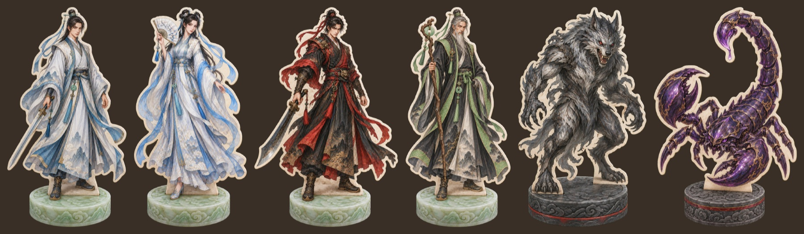
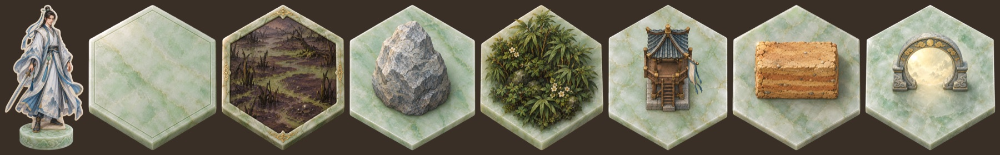

[앞의 대담](/ko/posts/game-completeness-dialogue/)에서 게임이 언제 완성되는지를 가르는 모델을 세웠다. 그 모델로 육각비경을 진단하니, 가장 큰 원인은 [다이내믹스](#g-dynamics)였고 연출과 난이도는 그다음 문제였다. 그래서 육각비경을 원점에서 다시 짜기로 했다.

이 글은 그 일을 맡은 hex-hop 프로젝트의 작업 에이전트와 나(강PD)의 대화다. 대화는 2026년 10월 13일 오후 4시에 시작해, 다음 날 오후 3시 56분까지 이어졌다. 오후 2시 40분에 대화를 한 번 문서로 남겼고, 그 뒤의 대화를 이어 붙였다. 원문 기록에서 흐름을 바꾼 대목만 골라 시간 순서대로 옮긴다. 내 말은 맞춤법만 다듬었고, 같은 말을 두 번 보낸 곳은 나중 것을 옮겼다. 에이전트의 답은 원문 문장을 살려 줄였다.

[AI Playground](https://playground.artificialmind.kr/)에서 해 볼 수 있는 육각비경은 아직 다시 짜기 전의 게임이다. 고치기 전의 육각비경은 [턴제](#g-turn)(turn-based) [로그라이크](#g-roguelike)(roguelike)인 [Hoplite](#g-hoplite)에 [Vampire Survivors](#g-vs)식 성장을 섞은 게임이었다. 플레이어가 [AI 수사](#g-rival) 셋과 겨루며 넓은 육각 비경을 돌고, 영기를 모아 먼저 경지에 오르려 다투는 게임이었다.

  <figure>
    
    <figcaption><strong>다시 짜기 전의 육각비경</strong><em>한 판은 돌지만 완성되었다고 느끼지 못한 게임</em></figcaption>
  </figure>

## 읽기 전에

대화는 [MDA 프레임워크](#g-mda) 위에서 오간다. 게임을 [메커닉스](#g-mechanics), 다이내믹스, [에스테틱스](#g-aesthetics) 세 층으로 보는 틀이다. 만드는 사람이 손대는 것은 규칙(메커닉스)이고, 규칙이 플레이에서 만드는 움직임(다이내믹스)을 거쳐서만 플레이어가 느끼는 재미(에스테틱스)에 닿는다. 앞의 대담에서 우리는 노리는 재미, 곧 [목표 에스테틱스](#g-target)가 플레이에서 실제로 일어나야 게임이 완성된다고 정했다.

이번 대화는 그 순서를 거꾸로 밟는다. 무엇을 느끼게 할지를 먼저 정하고, 그 재미를 낳을 판의 움직임을 정하고, 마지막에 규칙과 값을 정한다. 밑줄 친 말을 누르면 글 끝의 [용어 사전](#glossary)으로 간다.

## 근본 방향 (10-13 16:07)

**강PD** 새로운 이슈 검토하라. 중대한 의사결정 사항이다.

**에이전트** [시험용 대역](#g-bot)으로 40판(2,588턴)을 돌려 판의 구조를 쟀습니다. 시야 안에 맞수가 있는 턴은 6%이고, 40판 가운데 24판은 끝날 때까지 맞수를 한 번도 보지 못했습니다. 시야 안에 아무것도 없는 턴은 36%입니다. 위험한 칸이 있는 턴에도 98%는 안전한 칸이 함께 있었습니다.

1순위 원인은 다이내믹스입니다. Hoplite에서 수 싸움이 나는 것은 좁은 판에 적이 빽빽해서, 안전한 칸이 바닥나고 쓰러뜨리면서 빠져나가야 하기 때문입니다. 지금은 위험이 보여도 거의 언제나 안전한 칸이 따로 있어, 결정이 "칠해진 칸을 밟지 않는다"는 한 가지 규칙으로 줄어듭니다. [지배 전략](#g-dominant)이 생긴 것입니다. 원작의 조합(좁고 빽빽한 판)을 넓은 비경으로 바꾸면서, 원작이 검증해 준 재미가 사라졌습니다.

고칠 길로는 셋을 냅니다. A. 좁혀 오는 비경: 판이 지나며 비경의 바깥부터 닫혀 들어옵니다. B. 판 하나하나를 깊게: 몬스터가 다음 수를 예고하게 하고, 위험과 보상을 맞바꾸게 합니다. C. 순위를 다시 정하기: 탐색·수집(Discovery)을 1순위로 올립니다. 추천은 A입니다.

**강PD** 게임의 근본 방향성을 다시 검토하기로 했는데 그런 내용이 없나 보군?

**에이전트** 찾아봤지만 근본 방향을 다시 검토하기로 했다는 기록은 어디에도 없었습니다. 그래서 앞선 검토는 지금 방향(경쟁하는 수 싸움 게임)을 전제로 고칠 길만 냈습니다. 방향을 다시 본다면 [목적](#g-purpose)부터 고치게 됩니다.

**강PD** 이슈를 제기한 쪽에 알리겠다. 이슈 업데이트할 테니 기다려.

그사이 게임들이 함께 쓰는 [게임 베이스](#g-base)에 완성도 모델이 들어왔다. 에이전트는 바뀐 형식에 맞춰 이 게임의 [계약](#g-contract)을 옮겨 썼다.

## 계약보다 먼저 (17:37)

**강PD** 이제 게임 의도 변경 작업을 해 보자. 게임 베이스의 체계가 그것을 위한 바탕이다. 관련 논의를 [/ko/posts/game-completeness-dialogue/](/ko/posts/game-completeness-dialogue/)에 정리해 뒀다. 읽어 봐.

**에이전트** 대담에서 강PD는 B(수 싸움으로 되돌리기)에 기울었고, 세부는 이 프로젝트 작업자가 정하라고 했습니다. 그래서 B를 바탕으로 의도를 다시 짰습니다. 오늘 아침 제가 권한 "좁혀 오는 비경"은 거둡니다. 새 의도는 층마다 좁은 육각 비경에서 요괴와 맞수의 수를 읽고 베며, 다른 수사들보다 먼저 비경의 끝에 닿는 게임입니다.

*(내가 에이전트의 작업을 멈췄다.)*

**강PD** 지금은 contract-writing 단계가 아니다. 그전에 게임의 유형 및 목표 에스테틱을 정해야 해.

**에이전트** 목표 에스테틱스의 종류가 무엇을 먼저 볼지 정합니다. [Challenge](#g-challenge)이면 난이도를, Sensation이면 피드백을 먼저 봅니다. 후보는 셋입니다.

| | 1. 턴제 전술 경주 | 2. 탐험·생존 경쟁 | 3. AI 맞수와의 심리전 |
| --- | --- | --- | --- |
| 1순위 | [Tactical Mastery](#g-tactical)(수 싸움) | [Discovery](#g-discovery) | Tactical Mastery. 대상이 판보다 맞수의 마음 쪽 |
| 빌릴 조합 | Hoplite, [Into the Breach](#g-itb) | [배틀로얄](#g-br), [Extraction](#g-extraction) | 마땅한 원작이 없음 |

1을 권합니다. 원작 조합을 지키면 재미의 검증을 빌릴 수 있는 유일한 후보입니다.

**강PD** 목적도 다시 정의해야 한다.

## 원점에서 (17:44)

**강PD** 원점에서부터 다시 검토할 거야. 체스 같은 보드게임 스타일로 가려고 한다.

**에이전트** 지금 계약과 앞의 후보 셋은 내려놓겠습니다. 체스에서 읽은 성질은 이렇습니다. 판 위에 숨은 것이 없고(완전 정보), 운이 없고, 기물마다 움직임이 다르고, 판이 작아 모든 수가 결정이고, 기물을 잃으면 되돌릴 수 없습니다. 지금 게임이 깨뜨린 것(넓은 필드, 안개, 회복, 운)을 처음부터 갖지 않는 유형입니다.

다만 [Jev](#g-jev)는 체스형 상대에 약할 수 있습니다. 주어진 선택지에서 고를 뿐 몇 수 앞을 내다보는 추론과 숫자에 약합니다. 정할 것은 여섯입니다. 몇이서 두는지, 판의 모양, 이기는 조건, 판 위의 중립 존재, 운, 이름과 테마입니다.

**강PD** 체스 유형을 그대로 따르지는 않는다. 필드 몹이나 랜덤 아이템이 운 요소를 줄 수 있다. 수사들이 경쟁하는 방식은 그대로 둔다. 체스처럼 여러 말을 움직이지 않는다. 판은 기존보다는 작지만 체스만큼 작게 하진 않는다. 어차피 죽으면 게임 오버이다. 기물을 읽는 것은 의미가 없다. 수 싸움과 경쟁이 공존하긴 한 듯. 이건 기본적인 룰인 거고 이제 이 게임만의 세부 에스테틱을 설정해야 한다.

## 목표 에스테틱스 (17:48)

**에이전트** 이 룰에서 이 게임만의 에스테틱스 후보를 뽑아, 플레이어가 그 순간 느끼는 것으로 적었습니다. outwit(다음 수를 읽고 한 수로 위험을 비키며 베기), pit-them(요괴를 맞수 쪽으로 끌고 가거나 맞수끼리 부딪치게 하기), read-the-rival, one-life, race, gamble, be-the-cultivator입니다. one-life와 race는 서로 당깁니다. 쓰러지면 끝이라 조심하고 싶지만, 늦으면 맞수가 먼저 오릅니다.

**강PD**
- outwit, pit-them, race+one-life 순으로 목표 설정하라.
- one-life는 약간 애매한데 체력이 있어서 한 번에 죽지는 않는다. 추가 기회가 있다고 볼 수 있을 듯. 하지만 위기 상황에는 매 수가 조마조마한 것은 맞다.
- be-the-cultivator 이거는 오바다. 그냥 선협풍 감성을 경험할 수 있다 정도가 적절할 듯.

에이전트가 써 온 문장을 나는 한국어 작문 기준(korean-prose)으로 다시 쓰게 했다. 다시 쓴 1순위 outwit은 "플레이어는 요괴와 맞수가 다음에 둘 수를 읽고, 위험을 비키면서 베는 수를 찾았을 때 수 싸움에서 이겼다고 느낀다"였다.

**강PD** 목표 에스테틱스 피드백
- '베는 수'라는 게 전문 용어가 아니다. 공격한다는 거지?
- '손안에 쥐었다'는 것도 바꿔야 할 듯.
- '누가 먼저 오를지' 어디에 오른단 말인가?
- 평범한 말 말고 전문 용어를 쓰자.

목적 피드백
- 수사 넷이 적절한지는 모른다. 확정하지 말라.
- 왜 체스보다 큰 판이어야 한다는 것의 의미를 어떻게 이해하고 있지?

확인할 것 답변
- 육각비경은 그대로

기타 의견
- 게임의 Visual Clarity(Readability)는 언제 정하지?
- Interesting Decision, 그중에서도 Risk-Reward 선택 요소는 언제 정하는가?

**에이전트** 문장을 다시 썼습니다. outwit은 "요괴와 맞수의 공격 예고([Telegraph](#g-telegraph))를 읽고, 한 수로 회피와 공격을 함께 해낼 때 수 싸움에서 이겼다고 느낀다"입니다. pit-them은 요괴의 [어그로](#g-aggro)(aggro)를 맞수에게 넘기거나 맞수끼리 싸우는 틈에 끼어드는(third-party) 것으로, race-on-the-edge는 [Suspense](#g-suspense), [Risk-Reward](#g-riskreward), [Stakes](#g-stakes)로 적었습니다.

판의 크기는 이렇게 이해합니다. 체스판이 작아도 되는 것은 기물이 많아 모든 칸이 늘 누군가의 영향 아래 있기 때문입니다. 이 게임은 수사마다 말이 하나라, 체스만큼 작으면 처음부터 서로 맞닿습니다. 그러면 다가갈지 피할지 같은 거리를 고르는 결정이 사라집니다. 반대로 지금처럼 크면 맞닿을 일이 드물어 [Dead Time](#g-deadtime)이 됩니다. 그래서 판의 크기는 숫자가 아니라 "결정의 밀도를 지키면서 거리를 고를 여지를 남기는 크기"라는 조건입니다.

[Clarity](#g-clarity)와 [Interesting Decision](#g-interesting)은 둘 다 다이내믹스 단계에서 정합니다. 다만 모델에 빈자리가 있습니다. Interesting Decision과 Risk-Reward는 정의만 있고, 계약에도 결정을 적는 칸이 없습니다. 그래서 핵심 결정 표부터 만들기를 권합니다.

**강PD**
- '판을 조종했다' 이거는 영어의 감각인 듯? 어떤 수를 쓸지 예측해서 맞추거나 상대의 수를 유도했다는 것을 말하는 거지?
- third-party라는 용어는 빼라.
- 판의 크기 이해는 적절하다.

에스테틱스 위에 의견 적용하라. 승인한다.

## 동기 (18:17)

**강PD** 그래 초안 제시하라. 한 번에 하나씩 검토한다.

**에이전트** 결정 후보는 여섯입니다. 공격과 회피, 거리 고르기, 어그로 넘기기, 끼어들기, 아이템 노리기, 서두르기와 버티기. 첫째인 공격과 회피부터 드립니다. 가장 안전한 칸과 가장 많이 공격하는 칸이 자주 달라야 합니다.

**강PD** 그 전에 상대를 공격해서 격퇴하거나 아이템을 노리는 이유와 승리 조건의 연관성이 있어야 한다.

**에이전트** 맞습니다. 공격하거나 아이템을 노리는 까닭이 승리 조건과 이어져 있지 않으면 동기 없는 결정이 됩니다. 후보는 A 점수 경주, B 출구 경주, C 최후의 1인, D 인장 모아 탈출입니다. D를 권합니다. 인장 N개를 지닌 채 출구에 먼저 닿아야 이기고, 맞수를 쓰러뜨리면 그가 지닌 인장을 빼앗습니다. 인장을 많이 지닌 맞수일수록 노릴 값어치가 커서, 앞선 쪽이 모두의 표적이 되는 리더 견제가 저절로 생깁니다. Extraction의 "모은 것을 들고 나가야 내 것"과 Hoplite의 수 싸움을 섞은 꼴입니다.

**강PD**
- D로 하자. 요괴에게만 인장을 획득하지 말고 특정 포인트에서도 획득하게 하자. 그러면 서로 만나게 하는 요소가 될 듯.
- 누가 얼마나 앞섰는지가 늘 보이는 것은 생각해 봐야 할 듯. 몰라도 의미가 있지 않나. 시야에 보였을 때 알 수 있게 하거나. 고민된다.
- 즉 다이내믹스에는 동기가 연결되어야 한다. 모델 업데이트 후보로 넣자.

**에이전트** 정해진 지점은 업계에서 [오브젝티브](#g-objective)(objective) 또는 거점(control point)이라 부르는 것과 같습니다. 앞선 정도를 숨기는 데에는 의미가 있습니다. 다만 위협을 숨기면 진 까닭을 알 수 없어 [Fairness](#g-fairness)를 해칩니다. 안은 셋입니다. 가. 모두의 인장 수가 늘 보인다. 나. 시야 안에서만 보인다. 다. 숨기되, 누가 N개를 다 모으면 모두에게 알린다.

**강PD**
- 가안은 게임이 단순해져서 좋은 것 같다. 문제는 너무 단순해진다는 거야. 일단 가로 가자. 단순함 안에서 충분한 완성도를 만들어 낼 수 있는지 시도해 보겠다.
- Fairness는 필수가 아니다. 때로는 Unfairness가 재미 요소가 되기도 한다.
- 3번에서 승리 조건이라면 승리가 중요한 게임에만 적용된다. 다른 용어가 좋을 듯.

**에이전트** Fairness를 지켜야 할 조건처럼 다룬 전제를 거둡니다. 운 좋은 드롭이나 뒤처진 쪽을 돕는 장치처럼 불공정함이 재미가 되기도 합니다. "승리 조건"은 계약에 이미 있는 칸의 말인 플레이어의 [목표](#g-goal)(goal)로 바꿨습니다. 이기고 지는 것이 없는 게임에도 성립합니다.

다음은 쓰러진 수사의 인장이 어디로 가는지입니다. 가. 막타를 친 수사가 모두 가져간다. 나. 쓰러진 자리에 떨어져 먼저 줍는 쪽이 갖는다. pit-them이 가장 분명한 가를 권합니다.

> **다이내믹스에는 동기가 이어져 있어야 한다.** (잠정) 플레이어가 어떤 행동을 고를 까닭이 플레이어의 목표와 그 보상 구조까지 이어지지 않으면, 그 행동을 둘러싼 결정은 Interesting Decision이 되지 못한다.

**강PD**
- Fairness 내용 모델에 적용하라.
- 원거리 공격이 가능하기 때문에 바닥에 떨어지는 게 맞다.

**에이전트** 원거리 공격이 있으니 막타가 인장을 가져가게 하면, 멀리서 막타만 쳐 위험 없이 인장을 챙기는 수가 지배 전략이 됩니다. 바닥에 떨어지면 결국 그 자리로 다가가야 하므로, 쓰러진 자리가 새 거점이 됩니다. 출구는 처음부터 열어 두고, 인장 N개를 지닌 수사만 들어가게 하는 가안을 권합니다.

## 거점이 센터다 (18:39)

**강PD**
- 가안 승인한다. 이거는 플레이해 보고 조정을 검토하겠다.
- 그리고 거점이라는 키워드가 중요한 것 같다. 어떻게 생각해?

**에이전트** 저도 거점이 이 게임의 중심 장치라고 봅니다. 지금까지 정한 것들이 모두 거점으로 모입니다. 수사들이 만날 자리를 만들어, 맞수를 본 턴 6%라는 가장 큰 문제를 판의 크기가 아니라 동기로 풉니다. 인장의 출처가 되고, pit-them의 무대가 되고, 거점이 언제 열리고 비는지가 [Pacing](#g-pacing)을 만듭니다. [MOBA](#g-moba)의 드래곤과 바론, [King of the Hill](#g-koth)의 점령 지점, 배틀로얄의 보급품이 같은 역할을 합니다. 공통점은 언제, 어디서 싸움이 날지를 플레이어가 예고받고 준비한다는 것입니다.

**강PD** 동의한다. 거점이 게임의 '센터(center)'인 것이다. 이것들을 중심으로 다이내믹들이 생기고 에스테틱을 경험하게 된다. 거점 중심으로 얼라인을 잘 시키자.

이어서 거점의 규칙을 하나씩 정했다. 인장은 구역 안에 정해진 턴 동안 머물러 점령해야 얻는다. 다른 수사가 구역에 함께 있으면 점령이 멈추고, 구역을 나가면 처음으로 돌아간다. 거점이 언제 열리는지에 대해서는 에이전트가 한 번에 일부만 차례로 여는 나안을 권했다. 다음에 열릴 거점은 무작위로 고르고 미리 알리자고 했다.

**강PD** 나안 승인한다. 무작위로 고르고 미리 알리자. 거점 근처에는 필드 몹이 있거나 거점이 활성화되면 필드 몹이 생성되는 건 어떨까?

**에이전트** 좋은 생각이라고 봅니다. 늘 지키는 가안보다, 열리는 순간 둘레에 요괴가 나타나는 나안을 권합니다. 열리는 순간 둘레에 요괴가 나타나고, 나타날 칸을 미리 보이면 매복의 지배 전략을 막습니다. 다음 거점에 먼저 가서 기다리면, 요괴가 나타날 때 그 수사가 먼저 맞습니다. 거점이 열릴 때마다 요괴를 조금씩 세게 하면 [Escalation](#g-escalation)이 거점을 중심으로 눈에 보입니다.

**강PD** 나안 승인한다. 떠도는 요괴도 적게 두자. 요괴가 어느 지점에 생성되는지에 따라 양상이 다를 것이다.

**에이전트** 근접 요괴는 구역 둘레에, 원거리 요괴는 구역을 겨눌 수 있는 자리에 두면, 구역 안 몇 칸이 원거리 요괴의 사선이 됩니다. 그러면 점령하는 동안 어느 칸에 설지가 매 턴의 수 싸움이 됩니다.

## 산과 골 (18:49)

**강PD** 권한 대로 하자. 그리고 필드 몹을 잡거나 필드를 탐색해야 하는 이유도 있어야 한다. 영기를 모아서 성장해야 더 강해지고 그래서 거점 경합 때 유리해질 수 있다. 또한 이동에 관한 스킬이나 지형지물 관련 다양한 스킬이 있어야 경주가 다이내믹해진다. 똑같이 움직이면 단조로워진다.

**에이전트** 거점을 센터로 놓고 보면, 지금까지는 거점이 열려 경합하는 산만 정했고, 거점 사이의 골에서 무엇을 할지가 비어 있었습니다. 골이 비면 그 시간은 Dead Time이 됩니다. 재화는 둘로 나뉩니다. 영기는 강해지는 데 쓰고, 인장은 이기는 데 씁니다.

  

    
골 · 거점 사이<strong>사냥과 탐색</strong><em>떠도는 요괴와 필드의 영기 → 경지가 오르고 스킬을 고른다</em>

    
산 · 거점이 열림<strong>점령과 경합</strong><em>거점 요괴와 맞수 사이에서 버텨 인장을 얻는다. 쓰러지면 인장이 떨어진다</em>

    
끝 · 출구<strong>인장을 들고 탈출</strong><em>인장을 다 모으면 출구로 달리거나, 다음 거점까지 버틴다</em>

  

**강PD** 거점에서 인장을 획득하면 필드 몹과 전투가 필연적으로 따르게 된다. 성장도 챙길 수 있는 거지. 또는 성장이 받쳐 주지 않으면 거점을 지킬 수 없다. 어떤 면에서 성장은 중요한 축이 된다.

**에이전트** 그 관계가 핵심입니다. 성장은 거점이라는 센터를 받치는 축이고, 거점은 성장을 기르는 자리입니다. 서로를 키우는 고리는 앞선 쪽을 계속 앞서게 합니다([스노볼](#g-snowball)). 이것을 누르는 장치는 이미 정한 것 안에 있습니다. 인장이 바닥에 떨어지고, 점령하는 수사는 드러나고, 거점을 놓친 수사는 필드에서 따로 성장해 따라잡을 수 있습니다.

**강PD** 거점에서 요괴와 싸우면 피해를 입게 된다. 약해지는 순간이 있는 거지. 이때 다른 수사가 막타를 칠 수 있지 않을까?

**에이전트** 칠 수 있고, 그것이 pit-them이 거점에서 저절로 생기는 순간입니다. 먼저 들어간 수사가 요괴와 싸우며 체력이 깎이는 동안이 약해지는 창(window)이 되고, 밖에서 기다리던 수사가 그 틈에 [막타](#g-lasthit)(last hit)를 노립니다. 다만 막타가 너무 이득이면 아무도 먼저 들어가지 않습니다. 거점이 열려 있는 턴에 끝을 두면 누군가는 들어가야 합니다([Clock](#g-clock)).

나는 성장을 목표 에스테틱스로 올리기로 했다. 에이전트는 grow-to-hold라는 이름으로 문장을 쓰고, race-on-the-edge 다음인 4순위에 두는 가안을 권했다.

## 스킬과 AI의 판단 (19:12)

**강PD** 가안으로 하자. 이동·지형 스킬로 넘어가자. 참고로 상대의 스킬을 알아야 대응을 준비할 수 있다.

**에이전트** 스킬 후보는 축지(직선으로 몇 칸을 단숨에 건넌다), 장풍(이웃한 상대를 한 칸 밀어낸다), 섭물, 토벽(빈칸에 몇 턴 동안 바위를 세운다), 이형환위입니다. 처음에는 축지, 장풍, 토벽 셋을 권합니다.

**강PD** 권장대로 정하겠다.
- Jev 선택 모델을 고도화해야 한다. 그냥 여러 개 주고 결정하는 게 아니라 싸움이나 회피 등을 먼저 선택하고 후속 행동을 선택하는 등 고도화할 방법을 고안해야 한다.
- 거점에서 맡는 일 전문 용어로 바꿔라.

**에이전트** 스킬이 맡는 일은 [로테이션](#g-rotation)(Rotation), [이탈](#g-disengage)(Disengage), [강제 이동](#g-displacement)(Displacement), [구역 장악](#g-zoning)(Zoning)입니다. Jev는 업계에서 [계층적 의사 결정](#g-hierarchical)(hierarchical decision making)이라 부르는 꼴로 고도화하겠습니다. 의도(Intent)를 먼저 고르고, 그 의도 안에서 수를 고릅니다. 의도를 받은 뒤 다시 부르면 기다림이 두 배가 되니, 한 번의 호출에 함께 묻겠습니다.

**강PD** Jev 여러 번 불러도 된다.

**에이전트** 여러 번 불러도 된다면 층마다 Jev를 따로 부르겠습니다. 의도는 다시 고를 때만 묻고, 그 의도를 이룰 수는 매 턴 묻습니다.

**강PD**
- 두 번 호출로 충분할까? 더 많이 불러도 된다. Jev의 응답 속도는 0.1 정도로 알려져 있다.
- 다이내믹스 기획 마무리하자.

**에이전트** 두 번에 묶일 까닭은 없습니다. 층을 잘게 나눌수록 질문마다 선택지가 적고 사실이 서로 뚜렷이 달라집니다. Jev가 가장 잘 고르는 꼴이 그것입니다. 의도, 대상, 수, 자리로 나눌 수 있습니다.

**강PD** 현재 상태 파악이 1단계로 해야 할 듯.

**에이전트** 무엇을 파악할지 확인하겠습니다. Jev의 실제 응답 시간, 지금 코드의 자산 목록, 지금 AI 수사의 행동 가운데 무엇입니까?

**강PD** 아니, AI 플레이어가 지금 자신의 상태 파악을 먼저 해야 한다는 의미다.

**에이전트** 의도를 고르기 전에 AI 수사가 먼저 자기 처지를 판단하는 층을 두라는 뜻이군요. 업계에서는 상황 판단(situation assessment)이라 부르고, [OODA 루프](#g-ooda)의 "판단(Orient)"에 해당합니다.

**강PD** 이제 시작한 건지, 거점으로 이동해야 하는지, 적과 조우한 상태인 건지, 필드 몹 있는 상태인 건지, 나의 피가 적은지 상대의 피가 적은지 등등 다양한 상태가 있잖아. 이걸 고려해야 한다.

**에이전트** 처지는 낱말 하나가 아니라 여러 축이 겹친 상황 상태입니다. 업계에서는 이런 상태 묶음을 [월드 스테이트](#g-worldstate)(world state)나 블랙보드(blackboard)라 부릅니다. 판의 국면, 거점, 맞수와의 거리, 요괴, 내 체력, 맞수의 체력, 경쟁 위치, 성장 비교, 스킬은 규칙이 계산해 뜻으로 넘깁니다. "이길 수 있는 싸움인가", "거점에 제때 닿고 버틸 수 있는가"처럼 저울질하는 판단만 Jev가 합니다. 수사의 수는 넷(플레이어와 AI 수사 셋)을 권합니다.

**강PD** 권한 대로 하자. 수사는 일단 넷으로 가자.

*(이날 대화는 여기까지였다.)*

## 판의 크기와 운 (10-14 10:57)

전날 마지막 안은 거점 사이를 걸어가는 턴과 예고 턴을 비슷하게 맞추고, 판을 반지름 7 안팎으로 줄이는 것이었다.

**강PD** 거점 사이를 걸어서 가는 턴이 비슷할 필요 없다. 누군가는 빨리 도착하고 누군가는 늦게 도착할 수 있다. 운이 작용할 수 있는 거지. 그 상황에 맞게 판단을 해야 한다. 이러한 변수들이 게임 다이내믹을 풍부하게 만들 거라고 본다. 어떻게 생각해? 그리고 플레이어가 한 번에 인지할 수 있는 것보다 판의 크기가 커야 한다. 이것도 다이내믹을 만들어 줄 거라고 생각한다.

**에이전트** 두 가지 모두 동의합니다. 배틀로얄의 자기장 운(zone luck)과 같은 결입니다. 판이 커지면 [불완전 정보](#g-imperfect)(Imperfect Information)가 생겨 탐색할 까닭과 뜻밖의 조우가 생깁니다. 첫 판이 실패한 까닭은 판이 커서가 아니라 모일 곳이 없어서였다고 봅니다. 이번에는 거점이 주기적으로 모두를 한곳으로 끌어당깁니다. 다만 늦게 닿는 쪽에도 쓸 만한 수가 있어야 합니다.

**강PD** 가까운 수사가 유리한 것은 맞다. 다른 플레이어는 어느 정도 불리함을 안고 싸우는 거다. 플레이어가 극복해야 할 과제가 생기는 거지. 거꾸로 유리한 상태에서 싸우는 경험도 하게 된다. 플레이어는 이런 전장의 생리를 받아들여야 한다.

**에이전트** 가까운 수사가 유리한 것을 고칠 문제로 보지 않고, 판이 일부러 고른 비대칭(asymmetry)으로 두겠습니다. 불리한 판은 극복해야 할 과제가 되고, 유리한 판은 그 이점을 지켜 내는 싸움이 됩니다.

**강PD** 상대의 이점을 무너뜨릴 전략을 찾고 자신의 이점을 지킬 전략을 찾는 거지. 그걸 극복할 방법이 없으면 안 된다. 배틀로얄류는 건슈팅이어서 상대가 강해도 쏘면 죽는다.

**에이전트** 건슈팅에서는 강한 상대도 맞으면 죽기 때문에 높은 [치명성](#g-lethality)(lethality)이 [Equalizer](#g-equalizer) 노릇을 합니다. 그래서 원칙을 하나 세우고 이점마다 [대응 수단](#g-counterplay)(Counterplay)을 짝짓겠습니다. 원칙은 "모든 이점에는 그것을 무너뜨릴 수가 있다"입니다. 점령하고 있는 수사는 장풍으로 구역 밖으로 밀어내고, 성장한 수사에게는 성장 격차에 상한을 둡니다.

**강PD**
- 장풍으로 밀어내는 수는 현실성이 없다. 다시 들어오면 어떻게 할 것인가?
- 현재 시스템은 한 플레이어가 성장해서 체력도 높고 방어막도 있으면 치명상을 입히기 어렵다. 함정을 파거나 기습으로 치명상을 입힐 수 있어야 한다.

**에이전트** 다시 들어오면 한 턴을 번 것밖에 안 됩니다. Hoplite의 방패 밀치기(bash)도 적을 용암으로 밀 때 값이 생깁니다. 정면 싸움에서는 성장한 쪽이 이기는 것을 그대로 두고, 정면이 아닌 수에만 격차를 넘는 힘을 주겠습니다. 시야 밖에서 친 첫 공격은 방어막을 무시하는 [기습](#g-ambush)(Ambush), 밟으면 최대 체력에 비례한 피해를 주는 함정(Trap)입니다.

**강PD** 서로 시야가 비슷하기 때문에 안 보이는 곳에서 타격하기는 어렵다. 시야 개념을 넣든가. 장거리 타격 기술 같은 게 있어야 할 듯.

**에이전트** 시야가 서로 같으면 내가 칠 수 있는 상대는 나도 볼 수 있어서, 기습이 성립하지 않습니다. 두 길을 함께 쓰기를 권합니다. 하나는 MOBA의 수풀처럼 시야를 가리는 지형([vision blocker](#g-blocker))이고, 다른 하나는 시야보다 멀리 닿는 장거리 타격입니다. 기습의 조건은 "지난 턴에 상대가 나를 보지 못했으면, 내 첫 공격은 방어막을 무시한다"로 고칩니다.

**강PD** 기습은 방어막을 무시하는 게 아니라 2배, 3배로 가격되도록 하는 게 나을 듯. 방어막을 무시하는 건 말이 안 된다.

**에이전트** 기습은 방어막을 무시하지 않고, 들어가는 피해를 2배나 3배로 하겠습니다. 성장한 수사의 방어막에도 값이 남고, 기습은 그 방어막을 한 번에 깎고 체력까지 닿을 수 있습니다.

**강PD**
- 원칙 '모든 이점에는 그것을 무너뜨릴 수가 있다.' 이것은 확정이 아니다. 대체로 그렇다는 거지.
- 함정은 빼자. 수풀과 장거리 타격이면 충분할 듯.
- 장풍은 용도는 결정하지 않는다.
- 수풀에서 타격하면 은신이 풀려야 한다. 장거리 타격하려면 멀리 볼 방법이 필요하다.

**에이전트** 두 가지를 정해 주십시오.
1. 수풀의 은신이 풀린 뒤 얼마나 보이는가. 가. 공격한 턴부터 다음 자기 턴이 끝날 때까지(권함). 나. 수풀을 나갔다가 다시 들어오기 전까지.
2. 장거리 타격을 쏠 상대를 어떻게 보는가. 가. 거점을 점령하는 수사의 자리는 판 전체에 보인다(권함). 나. 망루 같은 높은 곳에 서면 시야가 넓어진다.

**강PD**
1. 나로 한다. 수풀 안에 있는 게 무조건 유리하면 안 된다.
2. 나로 한다. 거점이나 주요 길목을 볼 수 있는 망루를 설치해 두자.

## 맞수를 읽는 법 (11:28)

**에이전트** AI 수사의 의도를 얼마나 보일지 정합니다. 의도를 다 보이면 읽을 것이 사라지고, 아무것도 보이지 않으면 읽을 근거가 없어 운이 됩니다. 안은 셋입니다. 가. 의도를 그대로 보인다. 나. 아무것도 보이지 않는다. 다. 의도는 숨기고, 의도를 짐작할 [단서](#g-tell)(Tell)를 시야 안에서 보인다. 다를 권합니다. 체력, 경지, 든 스킬, 지난 몇 턴의 이동 자취가 단서입니다.

**강PD** 다로 간다. 수사의 스킬이 무엇인지는 파악할 수 있어야 한다. 방어 쪽인지 공격 쪽인지, 장거리 스킬이 있는지, 이동기가 있는지를 알아야 대응 전략을 짤 수 있다.

**에이전트** 판이 시작할 때 모든 수사의 스킬을 보이고, 스킬마다 역할(이동, 장거리, 방어)이 한눈에 보이게 하겠습니다. 하나만 더 정해 주십시오. 시야 안 수사의 남은 재사용 대기(cooldown)까지 보일지(가), 어떤 스킬을 가졌는지만 보일지(나)입니다.

**강PD**
- 스킬은 시야에 들어왔을 때 확인할 수 있다.
- 현재 유저가 항상 선수를 두게 되었는데 한 턴 안에서 행동의 순서를 정해 둬야 할 듯. 순서 바꾸는 방법도 있어야 할 듯.
- 어떤 스킬을 가졌는지만 보여야 한다.

**에이전트** 거점에서는 누가 먼저 움직이느냐가 막타와 점령을 가르기 때문에, 순서 자체가 큰 이점이 됩니다. 기본 순서의 안은 셋입니다. 가. 턴마다 맨 앞 자리가 한 칸씩 돌아간다(권함). 나. 속도([이니셔티브](#g-initiative), initiative) 값이 순서를 정하고, 성장하면 빨라진다. 다. 턴마다 무작위로 정한다.

**강PD** 나로 한다. 그리고 성장하면 속도가 빨라지는 게 아니라, 속도를 선택지로 주자. 그러면 선수를 가져갈지 다른 스킬을 가져갈지 선택하게 하는 거지. 처음 시작할 때 스킬을 하나 고르게 하자. 같은 속도일 때 순서 기준도 있어야 한다.

**에이전트** 같은 속도끼리는 지난 턴에 늦게 둔 쪽이 먼저 두는 안을 권합니다. 같은 속도의 수사들이 돌아가며 선을 잡아, 한 수사에게 이점이 굳지 않습니다.

**강PD** 다른 옵션 더 줘. 플레이어가 쉽게 이해할 방법이 좋다.

**에이전트** 고정 번호, 약한 쪽이 먼저, 먼 쪽이 먼저, 다친 쪽이 먼저를 더 냅니다. "약한 쪽이 먼저"를 권합니다.

**강PD** 아니다. 순서 시스템은 빼자. 그냥 고정으로 간다. 초반에 무작위로 순서가 정해지고 그 순서대로 돌아간다. 거점이 점령될 때마다 순서가 다시 무작위로 변경된다.

## 장거리 타격 (11:45)

**에이전트** 정한 것에서 나오는 Interesting Decision을 거점에 맞춰 열 가지로 모았습니다. 거점 예고가 떴을 때 그리로 갈지, 버리고 영기를 모을지, 다음 거점 자리로 미리 갈지. 거점에 먼저 닿았을 때 곧장 점령할지, 수풀에서 기다릴지. 장거리 타격을 쥐었을 때 지금 쏠지, 아낄지 같은 것입니다. 장거리 타격은 쏜 다음 턴에 떨어지고, 떨어질 자리는 미리 보입니다.

**강PD** 장거리 타격 예고는 뺀다. 맞았을 때 특정 망루에서 장거리 타격을 입었다고 느끼거나, 공격자가 예측 사격을 했다고 볼 수 있다. 범위 공격이고 재시도에 오래 걸리게 하자.

**에이전트** 맞은 쪽이 "저 망루에서 맞았다"고 느끼려면 날아온 방향이 보여야 합니다. 그래서 날아드는 궤적만 보이고, 쏜 수사가 누구이고 어디서 쏘았는지는 드러내지 않겠습니다. 빗나가면 오래 다시 쏘지 못합니다.

**강PD** 장거리 공격은 맞히든 빗나가든 다시 쏘는 데 오래 걸린다. 마무리하자.

계약의 목표와 다이내믹스를 문장으로 옮기며, 에이전트가 앞뒤 결정이 어긋나는 곳 셋을 찾아 물었다. 나는 인장 수를 시야 안에서만 보이게 하고, 맞수의 공격 범위는 칠하지 않기로 했다. 그러자 outwit의 문장이 바뀌어야 했다.

**에이전트** 고친 안: 플레이어는 요괴의 공격 예고(Telegraph)와 맞수가 드러낸 단서(Tell)를 읽고, 한 수로 회피와 공격을 함께 해내거나 맞수의 수를 내다보고 맞혔을 때 수 싸움에서 이겼다고 느낀다.

**강PD** 고친 안으로 정한다. 절차 3으로 넘어가자.

## 마감이 잘된 보드게임 (12:00)

에이전트가 새 설계로 계약을 다시 써 왔다. 판은 반지름 9, 스킬은 축지·장풍·토벽·장거리 타격, 지형은 바위·독 늪·수풀·망루다.

**강PD**
- 거점 요괴도 일반 요괴와 똑같이 행동한다.
- 바위는 시야를 가려야 한다.
- 구조 reshape 승인.
- Clarity는 언제 정하지?

**에이전트** 계약 승인 전인 지금이 정할 때입니다. 보이는 층([시각적 위계](#g-hierarchy), visual hierarchy)을 넷으로 나누겠습니다. 판 위에 늘, 수사 곁에, 화면 가장자리에, 열 때만. 확인 방법은 강PD가 아무 턴에서나 판을 3초 보고 세 가지를 말할 수 있는지입니다. 어디가 위험한가, 다음 거점은 어디이고 몇 턴 남았나, 내 차례는 몇 번째인가.

**강PD** 상위 아트 디렉션이 있어야 한다. 일단 마감이 아주 잘된 보드게임처럼 보이면 좋겠다.

**에이전트** 상위 아트 디렉션([art pillar](#g-pillar))을 먼저 세우면, Clarity의 표시도 "어떤 물건으로 보이는가"로 정리됩니다. 초안은 "선협 비경을 담은, 마감이 아주 잘된 보드게임 한 판"입니다. 정보는 덧그린 UI가 아니라 [구성물](#g-component)(component)로 보입니다. 거점은 금박 표식 토큰, 순서 막대는 이니셔티브 트랙, 내 상태는 플레이어 보드입니다. 판은 옥을 깎은 보드, 칸은 새겨 넣은 육각 타일, 수사는 받침이 있는 말입니다. 정해 주실 것은 셋입니다. 1. 이 문장과 원칙으로 갈지. 2. 글꼴: 지금의 도트 글꼴은 고급 보드게임의 결과 어긋나니, 제목은 붓글씨 결, 본문은 명조나 고딕으로 바꿀지. 3. 수사의 말: 위에서 내려다본 원형 토큰(가)으로 할지, 받침 위에 선 [스탠디](#g-standee)(나)로 할지.

**강PD**
- 아트 에셋 품질이 좋을수록 선택의 무게감을 더해 줄 거라고 본다.
- 줌인 줌아웃도 넣자.
- 1. 승인 2. 승인 3. 나로 간다.
- 웹 이미지로 만들자. 이미지 최적화가 있어야 할 듯.

**강PD** 승인.

**강PD** 가능하면 서브에이전트로 병렬 진행하자.

## 만들고 둬 보기 (12:19)

**에이전트** [서브에이전트](#g-subagent) 넷에게 나눠 맡겼습니다. 규칙 코어, 맞수와 판의 주인, 화면, 그림 파이프라인입니다. 모두 서로 겹치지 않는 파일만 고칩니다. 대역끼리 30판을 돌린 첫 기록을 첫 판과 견주면 이렇습니다.

| 지표 | 첫 판 | 새 설계 |
| --- | --- | --- |
| 시야에 아무것도 없는 턴 | 36% | 13% |
| 맞수를 본 턴 | 6% | 49% |
| 고를 만한 수가 둘 이상인 턴 | — | 72% |
| 판의 길이 | — | 평균 31턴 |

**강PD** 플레이해 봤는데 맵이 너무 좁다. 그리고 아트 에셋 재작업된 거 맞나? 기존 그대로인데?

**에이전트** 맞습니다. 아직 다시 만들지 않았습니다. 1단계에서는 그림을 만드는 도구만 고쳤고, 그림 자체는 4단계에 두었습니다. 앞의 보고에서 "그림은 임시"라고만 적어, 그림을 다시 만든 것처럼 읽힐 수 있었습니다. 맵이 좁다는 것은 판을 보는 창이 좁다는 뜻일 수도, 판 자체가 작다는 뜻일 수도 있습니다. 판을 키운다면 반지름 12를 권합니다.

**강PD** 둘 다다. 반지름 12로 가자.

에이전트가 기준 그림 세 장을 만들어 보였다. 나는 그 그림체로 가되 바닥 타일의 새김은 단순하게, 거점 토큰은 앞면 전체를 금박으로, 탁자는 짙은 호두나무색으로 정했다.

**강PD** 반지름을 15까지 키우자. 여전히 작다. 그리고 제자리에서 턴을 넘기는 것도 넣어야 한다. 마지막으로 필드 몹이 AI 플레이어를 공격하지 않는 것 같은데 확인해 봐.

**에이전트** 규칙에는 문제가 없습니다. 대역끼리 30판에서 재 보니 한 턴에 요괴에게 맞는 횟수가 플레이어 0.08번, AI 수사 하나당 0.06번으로 비슷했습니다. 그렇게 보인 까닭은 셋으로 짐작합니다. 맞수가 위험 칸을 잘 피하고, 요괴가 맞수를 친 일이 기록에 남지 않고, 맞수의 연출이 다음 그림에 덮입니다. 확인하다가 고친 것이 하나 있습니다. 맞수에게 주는 사실이 시야 밖 요괴까지 셈해, 모르는 것을 아는 듯이 쓰고 있었습니다.

| 지표 | 반지름 12 | 반지름 15 | 첫 판(반지름 15, 거점 없음) |
| --- | --- | --- | --- |
| 시야에 아무것도 없는 차례 | 11% | 15% | 36% |
| 맞수를 본 차례 | 31% | 22% | 6% |
| 평균 판의 길이 | 39턴 | 49턴 | — |

같은 반지름 15인데도 첫 판보다 빈 턴은 절반 아래이고, 맞수를 보는 차례는 네 배쯤 많습니다. 거점이 수사들을 모으기 때문입니다.

**강PD** 그림 Codex CLI로 만들고 있는 거 맞지?

**에이전트** 맞습니다. 파이프라인이 `codex exec`를 한 장에 한 번씩 부릅니다. 요청마다 기준 이미지인 수사 스탠디를 붙여 같은 그림체로 그리게 합니다.

  <figure>
    
    <figcaption><strong>수사와 요괴 스탠디</strong><em>수사 넷은 옥 받침, 요괴 둘은 검은 돌 받침 위에 선다</em></figcaption>
  </figure>
  <figure>
    
    <figcaption><strong>타일과 지형</strong><em>바닥, 독 늪, 바위, 수풀, 망루, 토벽, 출구</em></figcaption>
  </figure>

**강PD** 승인.

## 층으로 나눈 판단 (14:14)

**에이전트** 2단계를 시작하려면 AI 수사의 행동 모델을 새 설계에 맞게 다시 짜야 합니다. 배운 것은 넷입니다. 판단은 층으로 나눈다. 의도를 이어 쓴다. 성격은 의도 층에서 가장 크게 갈린다. 모르는 것은 계산에도 쓰지 않는다. [사전부검](#g-premortem)도 했습니다. 층 넷에 맞수 셋이면 한 턴에 Jev를 최대 열두 번 부르니 차례가 느려질 수 있고, 의도는 "점령"인데 수는 거점에서 멀어지는 식으로 층끼리 어긋날 수 있습니다.

**강PD** 합치는 것 동의.

**에이전트** 그림을 게임과 소개 페이지에 넣었습니다. 옥 타일 위에 지형과 받침 위의 스탠디가 섭니다. 제목은 나눔붓, 본문은 고운바탕, 숫자는 Cinzel이고, 도트 글꼴은 걷어 냈습니다. 연출은 대기열로 틀어 맞수의 차례가 이어져도 끊기지 않습니다. 2단계(층별 판단)는 아직 진행 중입니다.

**강PD** 우리 대화 기록을 문서로 남기려고 한다. records/2026-10-13-game-quality.md를 참고하여 남기자.

## 다시 둬 보고 (14:45)

**에이전트** 2단계(층으로 나눈 맞수 판단)를 마쳤습니다. 상황 9개를 성격 셋에 한 번씩 보이고, 실제 Jev로 견준 결과입니다.

| 지표 | 한 번 묻기(1단계) | 층으로 묻기 |
| --- | --- | --- |
| 상황에 맞는 의도 | 26/27 | 25/27 |
| 성격마다 의도가 갈린 상황 | 3/9 | 6/9 |
| 차례당 Jev 호출 | 1번 | 2.85번 |
| 한 차례의 시간(평균 / 최대) | 236 / 466ms | 619 / 973ms |

가장 큰 변화는 성격입니다. 성격마다 의도가 갈린 상황이 두 배로 늘어, 버릇이 다른 맞수가 됩니다. 맞수 셋이면 한 턴에 2초 안팎으로, 플레이가 늘어질 정도는 아닙니다.

**강PD** 모두 승인 푸시하라.

**강PD** 플레이해 봤다.
- 일단 장거리 타격은 근거리에는 못 쓰게 하자. 그리고 10턴 정도로 [쿨타임](#g-cooldown) 설정.
- 몹의 숫자가 많은 것 같다. 20% 정도 줄이자.
- 그리고 스킬 중에 베기 +1이 있는데 베기 기능 자체가 없는데 스킬이 있는 게 이상하다.
- 지도가 여전히 작다. 대폭 키우자.

**강PD** AI 수사는 Jev 결정에 기반해서 [LLM](#g-llm)으로 대사를 말하도록 하자. 이러면 게임이 더 풍부해질 듯. Anthropic Sonnet 5.5를 쓴다.

**에이전트** 반지름을 15에서 22로 키웠습니다(721칸에서 1,519칸, 2.1배). 그런데 판이 넓어진 만큼 만남이 줄었습니다. 맞수를 본 차례가 22%에서 8%로, 첫 판(6%) 수준까지 떨어졌습니다. outwit과 pit-them은 맞수와 만나야 일어나므로, 이 값은 걱정됩니다. 반지름 22를 유지한다면 거점 자리를 다섯에서 아홉 안팎으로 늘리기를 권합니다.

"검기: 찌르기 피해 +1" 카드의 찌르기는 실제로 있는 규칙입니다. 적과 이웃한 칸에서 그 적과 이웃한 다른 칸으로 움직이면, 지나가며 그 적을 벱니다. 그런데 화면에 찌르기를 알리는 것이 도움말 한 줄뿐이라 없는 기능처럼 느껴졌습니다.

대사는 의도를 그대로 말하지 않고, 성격과 처지가 묻어나는 단서로 말하게 하기를 권합니다. "거점으로 간다"고 말해 버리면 읽을 것이 사라집니다. 판은 대사를 기다리지 않습니다. 대사가 오면 말풍선으로 띄우고, 안 오면 그냥 넘어갑니다.

정해 주실 것은 셋입니다. 1. 반지름 22를 유지할지, 거점 자리도 늘릴지. 2. 검기 카드를 어떻게 할지. 3. 대사를 위해 목적을 고친 안과 대사의 설계.

**강PD**
- 인장이 열리는 시간에 여유를 주자. 멀리서도 어느 정도 도달은 할 수 있을 듯. 이런 타이밍 조절이 다이내믹에 영향을 준다.
- 찌르기를 근접 공격용 기술로 바꾼다. 기술을 찌르기 말고 근처 2칸을 베는 거지. 업그레이드하면 3칸 베는 거고.
- AI 수사의 대사는 선협 분위기 관련 에스테틱을 살리기 위함이다. 언제 말하는가도 처음 조우했을 때도 말하게 하자.

1, 3 승인

**에이전트** 1의 승인에 따라 거점 자리를 아홉으로 늘렸습니다. 거점 예고에서 열리기까지를 11턴에서 16턴으로 늘렸습니다. 먼 수사도 어느 정도 닿을 수 있고, 축지를 쓸지 버릴지 고르는 타이밍이 생깁니다. 이제 걸음만으로는 공격하지 않습니다. 근접 공격은 새 수 "베기"입니다. 이웃한 칸 하나를 눌러 방향을 정하면 그 칸과 옆 칸, 두 칸을 벱니다.

**강PD**
- 계약 변경 승인. 거점은 5자리 유지.
- AGENTS.md의 '하지 않는 것'에서 '원작의 이름과 그림을 쓰지 않는다.'는 제거하라. 이미 원작 벗어난 독창적인 게임이 되었다.

**강PD** 계약의 그 문장도 지워라.

**에이전트** 대사 쪽 서브에이전트가 끝났습니다. 실제로 Sonnet 5.5를 불러 보았고, 한 줄에 1.6~2.3초 걸렸습니다. 받아 본 대사는 이렇습니다.

| 수사 / 계기 | 대사 |
| --- | --- |
| 청운 / 처음 마주침 | 첫 발을 디뎠으니 이제 검이 울 차례로다, 누가 오든 반갑게 맞으리라. |
| 적하 / 점령 | 첫 인장이다. 이 검이 남은 둘도 베어 오리라. |
| 묵린 / 기습을 당함 | 허허, 이만하면 얕은 생채기라 해두지. |
| 묵린 / 의도 변화(출구로) | 흐흐, 다들 서두르시게나. 주울 것은 내가 다 주워 갈 터이니. |
| 적하 / 처음 마주침 | 그대, 숨소리가 거칠구려. |

말투는 선협풍으로 잘 나옵니다. 다만 몇몇 대사는 의도를 꽤 드러냅니다. 얼마나 드러내도 될지는 플레이로 봐 주셔야 합니다.

## 판을 줄이고 소리를 입히다 (15:25)

**에이전트** 베기와 대사를 코드로 옮겼습니다. 대역 20판에서 걱정되는 것이 둘입니다. 판을 22로 넓힌 뒤 맞수를 마주치는 차례가 5%로 떨어졌습니다. 거점 다섯이 넓은 판에서는 모두를 모으지 못하는 것으로 보입니다. 또 찌르기를 베기로 바꾸며 근접이 크게 약해져, 대역끼리 두면 수사들이 요괴에게 밀려 쓰러집니다.

**강PD** 지도 크기를 약간만 줄이자. 그리고 필드 몹도 더 줄이자. 약간 난이도가 높은 듯. 대체로 플레이어들이 살아남지 못하는군.

**강PD** 마지막으로 사운드와 이펙트 마감 작업이 필요하다.

**에이전트** 반지름을 19로 줄이고(1,141칸), 떠도는 요괴는 넓이로 줄인 몫에 30%를 더 줄였습니다. 맞수를 본 차례는 5%에서 13%로 다시 늘었습니다.

지금 계약은 "소리를 쓰지 않는다"입니다. 상위 방향(마감이 잘된 보드게임)에 맞춰, 탁자 위 구성물의 소리와 선협의 소리를 섞자는 안을 냅니다. 말을 옮기면 나무 말이 옥 판에 툭 놓이는 소리, 거점 예고와 열림에는 편종이나 경쇠 한 번, 경지가 오르면 [고금](#g-guqin)(guqin) 한 소절입니다. 소리를 구할 길은 셋입니다. 가. 자유 라이선스([CC0](#g-cc0)) 효과음과 음악을 골라 다듬어 쓴다(권함). 나. 코드로 합성한다(WebAudio). 다. 생성 서비스로 만든다.

**강PD**
1. 승인
2. 승인
3. 가

**강PD** 브라우저의 [Web Audio API](#g-webaudio)로 실시간 합성도 검토하라.

**에이전트** 소리 엔진이 소리마다 파일로 낼지 실시간 합성으로 낼지를 고를 수 있게 바꿨습니다. 고금은 뜯는 현을 흉내 내는 합성법(Karplus–Strong)으로 오음 음계 한 소절을 냅니다. 버튼마다 합성 소리를 들어 볼 수 있는 소리 실험실 페이지도 만들었습니다. 에이전트는 소리를 직접 듣지 못합니다. 그래서 소리가 모두 나는지, 찌그러지지 않는지, 길이가 맞는지를 기계로만 확인했고, 품질은 짐작입니다. CC0 쪽은 편종과 고금의 녹음이 없어, 이 둘을 합성으로 메울 수 있을지 견줘 볼 자리입니다.

**강PD** 합성은 확인했는데 파일은 없는 걸로 나온다.

**에이전트** 맞습니다. 파일은 아직 하나도 없습니다. 내려받기는 승인을 받은 뒤에 하기로 해서, 실험실의 "파일 ▶" 칸이 비어 있습니다.

**강PD** 직접 받아라.

**에이전트** Kenney 묶음은 로그인 없이 받습니다. Freesound는 원본을 받으려면 로그인해야 해서, 공개 미리듣기 파일로 받습니다. 받기 전에 페이지마다 라이선스가 CC0인지 다시 확인하고, CC0가 아니면 뺍니다. 쓴 파일의 출처는 `CREDITS.md`에 적습니다.

**강PD** 아까 만든 대화록 최근 내용 추가하자.

## 덧붙임

대화를 다시 읽으니 같은 모양이 되풀이된다. 에이전트는 표와 권하는 안을 들고 와서 다음 단계로 서둘렀고, 나는 그 단계가 아직 아니라고 멈춰 세웠다. 계약보다 목적과 에스테틱스가 먼저였고, 결정 표보다 동기가 먼저였고, 의도보다 상황 판단이 먼저였다. 에이전트의 말을 업계 용어로 바꾸게 한 것도 앞 단계를 단단히 하려는 일이었다. 말이 정확해야 다음 단계의 판단이 흔들리지 않는다.

판의 크기는 대화 내내 오갔다. 에이전트는 반지름 7 안팎으로 줄이자고 했고, 나는 한눈에 보이는 것보다 커야 한다고 했다. 판은 반지름 9에서 12, 15, 22로 커졌다가 19로 돌아왔다. 대역끼리 둔 판에서 맞수를 본 차례는 그때마다 49%, 31%, 22%, 5~8%, 13%로 오르내렸다. 대역의 숫자만으로는 정할 수 없었고, 내가 둬 보고 "여전히 작다", "약간만 줄이자"고 말한 것이 값을 정했다. 새 설계는 아직 배포하지 않았다. 사람의 플레이에서 목표 에스테틱스가 일어나는지가 남은 물음이다.

<section class="gq-glossary" id="glossary">
<h2>용어 사전</h2>

본문에서 밑줄 친 말을 누르면 이곳으로 온다. 뜻은 이 대화와 그 뒤에 정리한 계약과 모델을 따랐다.

<h3>게임 설계의 틀</h3>
<dl>
<dt id="g-mda">MDA 프레임워크</dt><dd>게임을 메커닉스(mechanics), 다이내믹스(dynamics), 에스테틱스(aesthetics) 세 층으로 보는 게임 디자인 프레임워크. Hunicke, LeBlanc, Zubek의 2004년 논문에서 나왔다.</dd>
<dt id="g-mechanics">메커닉스(mechanics)</dt><dd>게임의 규칙과 플레이어가 쓸 수 있는 조작이다. 예: 거점 구역에 정해진 턴 동안 머물면 인장을 얻는다.</dd>
<dt id="g-dynamics">다이내믹스(dynamics)</dt><dd>규칙이 실제 플레이에서 만들어 내는 움직임이다. 예: 거점이 열리면 수사들이 한곳으로 모여 부딪친다.</dd>
<dt id="g-aesthetics">에스테틱스(aesthetics)</dt><dd>플레이어에게 일어나는 감정 반응, 곧 재미의 종류. MDA는 Sensation, Fantasy, Narrative, Challenge, Fellowship, Discovery, Expression, Submission 여덟 가지를 예로 든다.</dd>
<dt id="g-target">목표 에스테틱스</dt><dd>만드는 사람이 노리는 재미다. 여럿이면 순위를 매긴다. 이 대화에서 정한 육각비경의 순위는 outwit, pit-them, race-on-the-edge, grow-to-hold, xianxia-mood다.</dd>
<dt id="g-goal">목표(goal)</dt><dd>플레이어가 게임 안에서 이루려는 것. 승리 조건과 달리 이기고 지는 것이 없는 게임에도 쓸 수 있어 이 말을 골랐다.</dd>
</dl>
<h3>재미의 종류</h3>
<dl>
<dt id="g-challenge">Challenge</dt><dd>어려움을 이겨 내는 재미. MDA가 드는 에스테틱스의 예 가운데 하나다.</dd>
<dt id="g-tactical">Tactical Mastery</dt><dd>수를 읽고 두어 상대나 상황을 앞서는 재미. 강PD가 말한 '수 싸움'을 가리키려고 고른 말이며, 업계 표준 분류는 아니다.</dd>
<dt id="g-discovery">Discovery</dt><dd>새로운 곳이나 것을 찾아내는 재미.</dd>
<dt id="g-suspense">Suspense</dt><dd>무언가 걸린 결과를 기다리는 동안의 긴장.</dd>
</dl>
<h3>결정과 균형</h3>
<dl>
<dt id="g-interesting">Interesting Decision</dt><dd>정답이 하나로 정해지지 않아 절충을 따져야 하는 선택. 게임 디자이너 Sid Meier가 쓴 말이다.</dd>
<dt id="g-riskreward">Risk-Reward</dt><dd>위험을 더 지는 대신 더 얻는 선택.</dd>
<dt id="g-stakes">Stakes</dt><dd>한 결정으로 얻거나 잃을 수 있는 것과 그 무게.</dd>
<dt id="g-dominant">지배 전략(dominant strategy)</dt><dd>상황과 상관없이 늘 가장 나은 한 가지 수. 이것이 생기면 고를 것이 사라진다.</dd>
<dt id="g-deadtime">Dead Time</dt><dd>걸린 것도, 기다릴 결과도 없는 빈 시간.</dd>
<dt id="g-fairness">Fairness</dt><dd>진 사람이 왜 졌는지 알고, 대응할 기회가 있었는지의 정도. 이 대화에서 우리는 Fairness를 높을수록 좋은 값이 아니라, 게임마다 얼마나 공정할지 고르는 것으로 보기로 했다. 운 좋은 드롭처럼 공정하지 않은 결과가 재미가 되기도 한다.</dd>
<dt id="g-snowball">스노볼(snowball)</dt><dd>앞선 쪽이 그 이점으로 더 앞서 가, 격차가 눈덩이처럼 커지는 것.</dd>
<dt id="g-counterplay">대응 수단(Counterplay)</dt><dd>상대의 이점이나 전략을 무너뜨릴 수 있는 수.</dd>
<dt id="g-equalizer">Equalizer</dt><dd>실력이나 성장의 격차를 뒤집을 수 있게 해 주는 장치.</dd>
<dt id="g-lethality">치명성(lethality)</dt><dd>공격 한 번이 상대를 쓰러뜨릴 수 있는 정도. 건슈팅 게임은 치명성이 높아 강한 상대도 맞으면 쓰러진다.</dd>
<dt id="g-imperfect">불완전 정보(Imperfect Information)</dt><dd>플레이어가 판의 일부를 모르는 상태. 체스는 판 위에 숨은 것이 없는 완전 정보 게임이다.</dd>
</dl>
<h3>판의 흐름과 보이는 것</h3>
<dl>
<dt id="g-telegraph">Telegraph</dt><dd>다음에 올 위협이나 결과를 미리 보여 주는 것. 예: 요괴가 다음 턴에 칠 칸을 붉게 칠한다.</dd>
<dt id="g-tell">단서(Tell)</dt><dd>상대가 무엇을 하려는지 짐작하게 하는 겉으로 드러난 버릇이나 표시. 포커에서 온 말이다.</dd>
<dt id="g-pacing">Pacing</dt><dd>한 판 안에서 긴장이 오르내리는 흐름.</dd>
<dt id="g-clock">Clock</dt><dd>시간이나 진행에 따라 차오르며 플레이어를 몰아붙이는 장치. 예: 거점이 열려 있는 턴에 끝을 둔다.</dd>
<dt id="g-escalation">Escalation</dt><dd>판이 진행될수록 위협이 커지는 것.</dd>
<dt id="g-clarity">Clarity</dt><dd>선택에 필요한 정보와 그 결과를 보고 듣고 알아볼 수 있는 정도. Visual Clarity, Readability라고도 한다.</dd>
<dt id="g-hierarchy">시각적 위계(visual hierarchy)</dt><dd>화면의 정보를 중요한 차례대로 층을 나눠, 중요한 것일수록 먼저 눈에 띄게 하는 것.</dd>
</dl>
<h3>전장의 말</h3>
<dl>
<dt id="g-objective">오브젝티브(objective), 거점(control point)</dt><dd>판 위에서 모두가 노리는 자리나 대상. 차지하면 보상이 있어 플레이어들이 그곳에서 만난다. 육각비경에서는 거점이 판의 중심(센터)이다.</dd>
<dt id="g-koth">King of the Hill</dt><dd>정해진 지점을 차지하고 버텨 점수를 얻는 게임 방식. 다른 플레이어가 지점에 들어오면 점령이 멈추는 경합 규칙이 흔하다.</dd>
<dt id="g-aggro">어그로(aggro)</dt><dd>몬스터가 누구를 노리는지. 어그로를 넘긴다는 것은 몬스터가 다른 상대를 쫓게 만든다는 뜻이다.</dd>
<dt id="g-lasthit">막타(last hit)</dt><dd>상대를 쓰러뜨리는 마지막 한 방.</dd>
<dt id="g-ambush">기습(Ambush)</dt><dd>육각비경에서는 지난 턴에 상대가 나를 보지 못했을 때 내 첫 공격의 피해가 몇 배가 되는 규칙. 방어막은 그대로 피해를 받는다.</dd>
<dt id="g-blocker">시야를 가리는 지형(vision blocker)</dt><dd>그 안에 든 것을 밖에서 볼 수 없게 하는 지형. 육각비경의 수풀은 이웃한 칸에서만 보이고, 수풀에서 공격하면 나갔다 다시 들어오기 전까지 드러난다.</dd>
<dt id="g-rotation">로테이션(Rotation)</dt><dd>오브젝티브 사이를 옮겨 다니는 이동.</dd>
<dt id="g-disengage">이탈(Disengage)</dt><dd>불리한 교전에서 빠져나오는 것.</dd>
<dt id="g-displacement">강제 이동(Displacement)</dt><dd>상대를 밀거나 당겨 자리를 바꾸게 하는 것.</dd>
<dt id="g-zoning">구역 장악(Zoning)</dt><dd>지형이나 위협으로 상대가 어떤 곳에 들어오지 못하게 하는 것.</dd>
<dt id="g-cooldown">쿨타임(cooldown)</dt><dd>스킬을 한 번 쓴 뒤 다시 쓸 수 있을 때까지 기다리는 시간. 재사용 대기라고도 한다.</dd>
<dt id="g-initiative">이니셔티브(initiative)</dt><dd>한 턴 안에서 누가 먼저 움직이는지 정하는 값이나 규칙. 육각비경은 이 시스템을 빼고, 무작위로 정한 고정 순서를 거점이 점령될 때마다 다시 뽑기로 했다.</dd>
</dl>
<h3>AI 수사의 판단</h3>
<dl>
<dt id="g-rival">AI 수사</dt><dd>육각비경에서 플레이어와 겨루는 AI 플레이어. 수사는 선협 소설에서 도를 닦는 사람을 뜻한다.</dd>
<dt id="g-jev">Jev</dt><dd>TypeSafe의 선택 모델. 주어진 선택지 가운데 하나를 빠르게 고른다. 사람의 빠르고 직관적인 판단(시스템 1)에 해당하는 일을 맡고, 몇 수 앞을 내다보는 추론과 숫자에는 약하다.</dd>
<dt id="g-hierarchical">계층적 의사 결정(hierarchical decision making)</dt><dd>판단을 층으로 나누는 AI 설계. 위 층이 무엇을 할지(의도)를 정하면, 아래 층이 그 의도를 이룰 수를 고른다.</dd>
<dt id="g-ooda">OODA 루프</dt><dd>관찰(Observe), 판단(Orient), 결정(Decide), 행동(Act)을 되풀이하는 의사 결정의 틀. 군사 전략가 John Boyd가 만들었다.</dd>
<dt id="g-worldstate">월드 스테이트(world state), 블랙보드(blackboard)</dt><dd>AI가 판단에 쓰는 판 위의 상태를 한곳에 모은 것. 예: 내 체력, 맞수와의 거리, 거점이 열리기까지 남은 턴.</dd>
<dt id="g-llm">LLM(대형 언어 모델)</dt><dd>글을 읽고 써 내는 AI 모델. 육각비경에서는 Anthropic의 Sonnet 5.5가 AI 수사의 대사만 맡고, 판단은 Jev가 한다.</dd>
<dt id="g-bot">시험용 대역</dt><dd>AI 수사 대신 규칙대로 수를 두는 프로그램. Jev를 부르지 않고 여러 판을 빠르게 돌려 판의 구조를 잰다.</dd>
</dl>
<h3>표현</h3>
<dl>
<dt id="g-pillar">상위 아트 디렉션(art pillar)</dt><dd>그림, UI, 글꼴, 모션이 모두 따르는 한 문장의 방향. 육각비경은 "선협 비경을 담은, 마감이 아주 잘된 보드게임 한 판"이다.</dd>
<dt id="g-component">구성물(component)</dt><dd>보드게임 상자에 든 물건. 판, 토큰, 카드, 말 같은 것이다. 육각비경은 화면의 정보를 이런 물건처럼 보이게 한다.</dd>
<dt id="g-guqin">고금(guqin)</dt><dd>일곱 줄을 뜯어 연주하는 중국의 옛 현악기. 선협풍 분위기를 내는 소리로 골랐다.</dd>
<dt id="g-cc0">CC0</dt><dd>저작자가 권리를 모두 내려놓아 누구나 출처 표시 없이 쓸 수 있게 한 라이선스.</dd>
<dt id="g-webaudio">Web Audio API</dt><dd>브라우저에서 소리를 만들고 다루는 표준 기능. 파일 없이 코드로 소리를 실시간 합성할 수 있다.</dd>
<dt id="g-standee">스탠디(standee)</dt><dd>두꺼운 종이에 인쇄한 그림을 받침에 세운 보드게임 말.</dd>
</dl>
<h3>우리 작업 방식</h3>
<dl>
<dt id="g-purpose">목적</dt><dd>프로젝트가 무엇을 왜 하는지, 성공 기준, 하지 않는 것을 적은 절. 강PD가 정한다.</dd>
<dt id="g-contract">계약</dt><dd>게임의 목표 에스테틱스, 다이내믹스, 메커닉스와 그 값을 적은 기획 문서. 에이전트가 이것을 읽고 게임을 만든다. 쓰는 절차(contract-writing)는 목표와 에스테틱스(절차 2), 메커닉스와 값(절차 3), 승인(절차 4) 순이다.</dd>
<dt id="g-base">게임 베이스</dt><dd>하루 게임이 새 게임을 만들 때 출발하는 템플릿 저장소. 여러 게임이 함께 쓰는 모델과 절차도 여기 있다.</dd>
<dt id="g-subagent">서브에이전트</dt><dd>작업 에이전트가 일을 나눠 맡기려고 띄우는 다른 에이전트. 서로 다른 파일을 고쳐 나란히 일한다.</dd>
<dt id="g-premortem">사전부검(pre-mortem)</dt><dd>일을 시작하기 전에 "이 일이 실패했다면 왜일까"를 먼저 따져 보는 방법.</dd>
</dl>
<h3>이야기에 나오는 게임</h3>
<dl>
<dt id="g-hoplite">Hoplite</dt><dd>육각 격자(hex grid)에서 하는 턴제 로그라이크. 적의 공격 범위가 모두 보이고 체력이 적어, 한 수 한 수가 수 싸움이 된다. 육각비경의 원작이다.</dd>
<dt id="g-vs">Vampire Survivors</dt><dd>자동 공격과 레벨업 성장을 중심으로 한 로그라이트(roguelite) 생존 액션 게임.</dd>
<dt id="g-turn">턴제(turn-based)</dt><dd>플레이어와 상대가 차례를 번갈아 가며 행동하는 방식.</dd>
<dt id="g-roguelike">로그라이크(roguelike)</dt><dd>판마다 맵과 상황이 무작위로 바뀌고, 죽으면 처음부터 다시 하는 장르.</dd>
<dt id="g-itb">Into the Breach</dt><dd>적이 다음 턴에 칠 곳을 미리 보여 주는(Telegraph) 턴제 전술 게임.</dd>
<dt id="g-br">배틀로얄(battle royale)</dt><dd>여럿이 넓은 맵에서 장비를 모으며 마지막 하나가 남을 때까지 싸우는 장르. 시간이 갈수록 안전 구역이 좁아진다.</dd>
<dt id="g-extraction">Extraction 장르</dt><dd>맵에서 전리품을 모아 탈출(extraction)해야 하는 게임. 죽으면 모은 것을 잃는다.</dd>
<dt id="g-moba">MOBA</dt><dd>두 팀이 맵 위의 오브젝티브를 다투는 실시간 전략 장르. 리그 오브 레전드의 드래곤과 바론이 정해진 때에 나타나는 오브젝티브다.</dd>
</dl>
</section>
